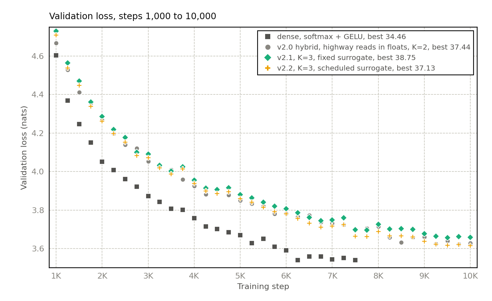
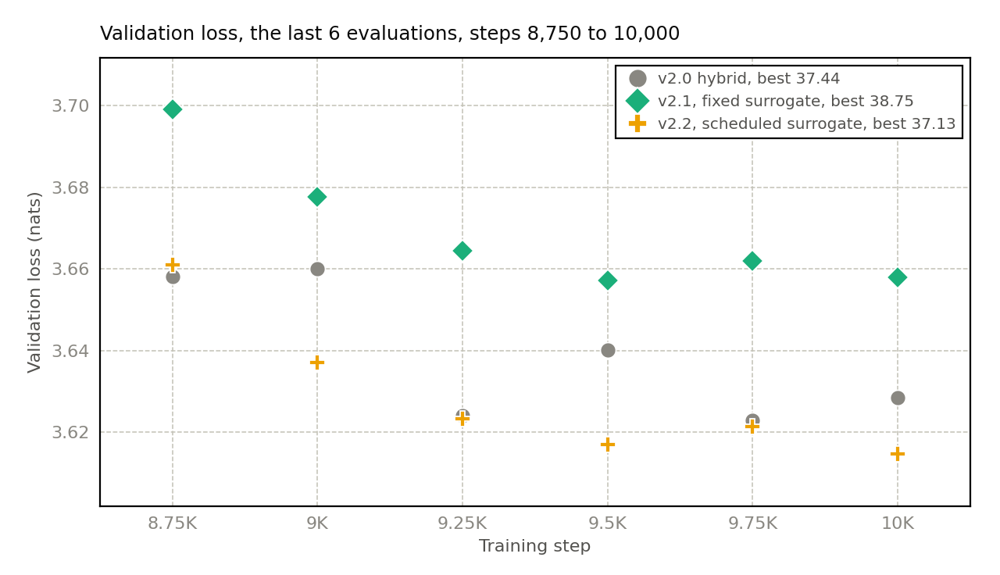
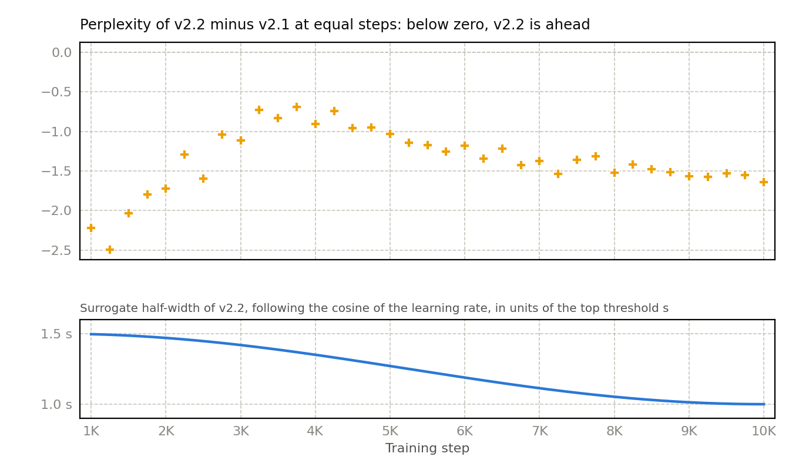

# FS²-SSA: Few-Spike, Softmax-Free Spiking Self-Attention

**A causal spiking language model on FineWeb-Edu (~94M parameters): no softmax anywhere, every matrix product inside the blocks fed by spikes, and an exact linear recurrence for inference.**

[](LICENSE)
[](https://doi.org/10.5281/zenodo.22950217)
[](https://huggingface.co/Matt-94/FS-SSA-LM-100M)

In this architecture the continuous Softmax is discarded entirely in favour of a causally masked, decay-weighted row normalisation. Few-spike (FS) neurons code values as signed discrete spikes in **$K=2$ or $K=3$ timesteps**, and in v2.1 they feed every matrix product of the blocks: the four projections (QKV, the output projection, the two MLP layers) and the two products of the attention. Inside the blocks a dense floating-point multiply-accumulate (MAC) becomes a sparse synaptic addition (AC); the output head is the only dense layer left.

The square in the name stands for the two FS of the design: **few-spike** coding and **softmax-free** attention. In file names and code it is written `FS2-SSA`.

This repository is the natural evolution of [FS-SSA](https://github.com/LRMTV94/FS_Softmax_Free_Attention), scaling softmax-free spiking self-attention from synthetic classifiers and toy benchmarks to open-domain autoregressive pretraining.

---

## Development trajectory

1. **Part 1, Ablation and Mechanics (TinyShakespeare):** a ~2.7M parameter character-level model (6 layers) evaluating stability, causal normalisation and threshold dynamics against a matched full-precision control.

2. **Part 2, Synthetic Scaling Proof (TinyStories):** a ~25.1M parameter model (12 layers, GPT-2 BPE) reaching a validation loss of **1.8163 ± 0.0139** (perplexity **6.15**), matching the loss regime of dense FP32 baselines on child-level narrative generation.

3. **Part 3, Real-World Open-Domain Scaling (FineWeb-Edu, v1):** a **93,884,544** parameter model (16 layers, 9 heads, context 1024, vocabulary 50257) pretrained on ~655M tokens of educational web text, benchmarked head to head against an iso-parameter, compute-matched dense Transformer. Full report in [docs/v1.md](docs/v1.md).

4. **Part 4, Linear-time inference (v2.0.0):** the same trained model, run as an exact recurrence with a fixed state per head, so that every new token costs the same however many came before. Full description in [docs/v2.md](docs/v2.md).

5. **Part 5, Spiking residual highway (v2.1.0):** the inputs of QKV, of the output projection and of the first MLP layer are coded into spikes too, and the fixed decay of each head becomes a decay computed token by token from those spikes. Its README is in [docs/v2.1.md](docs/v2.1.md).

6. **Part 6, Scheduled surrogate (v2.2.0, this release):** the same $K=3$ model, trained with a surrogate gradient sized to the threshold of each neuron, which narrows as the learning rate decays. The forward pass does not change, and the model reaches the validation loss of the v2.0 hybrid.

---

## Key results

<div align="center">

| model | projection inputs | decay | $K$ | validation loss | perplexity |
| :--- | :---: | :---: | :---: | :---: | :---: |
| Dense Transformer, Softmax + GELU (reference) | floats | softmax | n/a | 3.5399 | 34.46 |
| FS-SSA hybrid, v1 and v2.0 | floats | fixed ladder | 2 | 3.6228 | 37.44 |
| FS²-SSA v2.1 | spikes | fixed ladder | 2 | 3.7542 | 42.70 |
| FS²-SSA v2.1 | spikes | data-dependent | 2 | 3.6991 | 40.41 |
| FS²-SSA v2.1 | spikes | data-dependent | 3 | 3.6573 | 38.75 |
| **FS²-SSA v2.2, scheduled surrogate** | **spikes** | **data-dependent** | **3** | **3.6145** | **37.13** |

</div>

1. **Spiking the projection inputs costs 0.131 nats with the fixed ladder.** Coding the inputs of QKV, of the output projection and of the first MLP layer into spikes, instead of passing them as floats, moves the perplexity from 37.44 to 42.70.

2. **A decay computed from the spikes recovers 42% of that cost.** The data-dependent decay reaches 40.41 ($-0.0551$ nats) with 83,088 more parameters, 0.09% of the model.

3. **A third timestep recovers another 32%.** At $K=3$ the model reaches **38.75** ($-0.0419$ nats): 74% of the cost of the spiking inputs is recovered. The remaining gap is **+0.0344 nats** (+1.31 perplexity points) to the hybrid and +0.1174 nats to the dense control.

4. **The gains hold at every stage of training.** At equal steps, averaged over steps 1,500 to 3,000, 4,000 to 6,000 and 8,000 to 10,000, the data-dependent decay is ahead of the fixed ladder by 0.078, 0.063 and 0.064 nats, and $K=3$ is ahead of $K=2$ by 0.060, 0.053 and 0.043 nats. Each run uses seed 1; for scale, an independent rerun of the hybrid landed 0.008 nats from the original (3.6147 against 3.6228).

5. **A surrogate sized to each threshold reaches the hybrid.** v2.2 trains the $K=3$ model of v2.1 from the same initial weights, on the same batches, with one change in the backward pass: the surrogate gradient takes a half-width proportional to the threshold of each neuron and an area of 1, and narrows from $1.5\,s$ to $1.0\,s$ along the cosine of the learning rate. The model reaches **37.13** (3.6145, $-0.0427$ nats from v2.1 at $K=3$), level with the hybrid: 37.44 in the original run, 37.14 in its rerun. The hybrid was trained with the old surrogate, so this does not show that spiking the inputs comes for free: the new surrogate might lower the hybrid as well.

6. **The gain comes in two stages.** At equal steps v2.2 is ahead of v2.1 by 0.022 nats over steps 1,500 to 3,000, with the half-width still near $1.5\,s$, and by the same 0.022 nats over steps 4,000 to 6,000, as it narrows to $1.2\,s$; over steps 8,000 to 10,000, between $1.05\,s$ and $1.0\,s$, the gap grows to 0.039 nats. The first stage comes from the shape of the surrogate, before it narrows. The second comes with the end of the narrowing, which in this run is also the end of the learning rate decay, so the two cannot be told apart.

7. **Exact recurrence on the trained weights.** On the published $K=3$ checkpoint of v2.1 the parallel and the recurrent forms give identical logits in float64 and the same validation loss in float32 (3.69110 against 3.69117). v2.2 changes only the backward pass: its forward pass, and with it the recurrent form, is the one of v2.1.

8. **The two probes lost in v2.1 come back, one of them for the wrong reason.** In v2.1 the singular agreement across *"along with the students"* and the binding of Alvarez to volcanoes failed, where v1 passed both. v2.2 prefers `was` by 1.09 nats where v2.1 preferred `were` by 1.25, and the bias towards the plural behind that failure drops from 2.65 to 0.89 nats. It answers `volcanoes` again, but the four orderings of the prompt show that it picks the first object named and the word itself, not the object of the name asked: none of the three models measured binds. Details under [Qualitative probing](#qualitative-probing).

9. **Fluency does not change.** Over 30 prompts with 5 continuations of 250 tokens each, scored with GPT-2 large, the paired differences between v2.2 and v2.1 are all compatible with zero: share of repeated 4-grams $-0.013 \pm 0.025$, reference loss $+0.057 \pm 0.086$ nats, PMI with the prompt $+0.006 \pm 0.010$ nats per token (95% intervals over prompts). The single photosynthesis completion of v2.2 that drifts to bees is a bad draw.

<p align="center">
  
</p>

<p align="center">
  
</p>

---

## What is new in v2.2

### A surrogate gradient sized to each threshold

The forward pass of an FS neuron is a step: it fires when its potential crosses a threshold. The backward pass replaces the step with a triangle, the surrogate gradient. In v2.1 the triangle had one half-width for every neuron, 1.1 in units of the potential, and a peak of 1. The thresholds it serves are not alike: at initialisation the top threshold $s$ is 0.75 for the reads and the Q/K/V codes and 0.27 for the MLP neuron, and every channel then learns its own. A half-width of 1.1 is $1.5\,s$ for a read and $4\,s$ for the MLP neuron.

v2.2 changes the triangle and nothing else:

<div align="center">

| surrogate | v2.1 | v2.2 |
| :--- | :--- | :--- |
| half-width | 1.1, the same for every neuron | $c \cdot s$, with $s$ the top threshold of each channel, learned; no gradient flows through the width |
| peak | 1 | $1/(c \cdot s)$: the area stays 1, as for the step it stands for |
| $c$ during training | no schedule | 1.5 through the warmup, then down to 1.0 along the cosine of the learning rate |

</div>

With the area fixed, narrowing the triangle changes the shape of the gradient and not its size. $c = 1$ is the narrowest width at which the backward pass of a code never exceeds the slope of its forward pass: at $c = 0.75$ it would be 1.2 times steeper, at $c = 0.5$ 1.75 times, and the chain of resets would amplify the excess. Both choices have precedents: learning with surrogate gradients is robust to the shape of the surrogate and sensitive to its scale (Zenke & Vogels, 2021), and the sharpness of a surrogate can change during training (Li et al., 2021).

The forward pass, the 94,750,992 parameters and the recurrent form are those of the $K=3$ model of v2.1, so a v2.2 checkpoint loads in the classes of v2.1 as it is. The run starts from the same initial weights as the $K=3$ run of v2.1 and reads the same batches: their difference at equal steps is the effect of the surrogate.

<p align="center">
  
</p>

<div align="center">

| step | half-width | v2.1, $K=3$ | v2.2 | difference, nats | difference, perplexity |
| :---: | :---: | :---: | :---: | :---: | :---: |
| 1,000 | $1.50\,s$ | 4.7282 | 4.7084 | $-0.0198$ | $-2.22$ |
| 2,000 | $1.47\,s$ | 4.2853 | 4.2613 | $-0.0240$ | $-1.72$ |
| 3,000 | $1.42\,s$ | 4.0902 | 4.0714 | $-0.0188$ | $-1.11$ |
| 5,000 | $1.27\,s$ | 3.8806 | 3.8590 | $-0.0216$ | $-1.04$ |
| 7,500 | $1.08\,s$ | 3.6989 | 3.6648 | $-0.0341$ | $-1.36$ |
| 10,000 | $1.00\,s$ | 3.6579 | 3.6145 | $-0.0433$ | $-1.64$ |

</div>

In nats the gap holds near 0.02 for two thirds of the run and doubles in the last fifth. In perplexity it shrinks at first, because the same gap in nats is worth more points while the perplexity is high. From step 7,500 to its best, v2.2 gains 0.050 nats and v2.1 0.042. There is one seed per run: the growth of the second stage, 0.017 nats, is about twice the 0.008 nats by which the rerun of the hybrid moved.

### Fluency test

On the published prompts one completion of v2.2 leaves photosynthesis for bees after three words, where v2.1 stayed on topic. One completion says more about the seed than about the model, so `v2.2.0/fluency.py` samples 30 prompts, 5 continuations of 250 tokens per prompt and model, with the same random draws for both models, and scores every continuation with GPT-2 large, which shares the tokenizer:

<div align="center">

| score | what it measures | v2.2 minus v2.1 |
| :--- | :--- | :---: |
| rep-4 | share of repeated 4-grams in the continuation: the loops | $-0.013 \pm 0.025$ |
| reference loss | loss of the continuation under GPT-2 large, given the prompt, in nats per token | $+0.057 \pm 0.086$ |
| PMI | loss without the prompt minus loss with it: how much the continuation still depends on the prompt | $+0.006 \pm 0.010$ |

</div>

The prompts are the three of `generate.py`, twelve written by hand on other topics and fifteen beginnings of validation documents. The intervals are at 95%, from the spread between prompts, since the five continuations of one prompt are not independent. None of the differences is distinguishable from zero: the photosynthesis completion was a bad draw. The human continuations of the validation documents mark a limit both models share: a PMI of about 0.23 nats per token against about 0.13, and a rep-4 of about 0.017 against 0.08.

The script writes every continuation with its scores, and a copy with the two models in random order under the letters A and B, for a blind reading.

### Log-prob margins for the probes

The margin $\log p(\text{right}) - \log p(\text{wrong})$, in nats and computed in float64, measures the agreement and binding probes on a continuous scale, where a completion gives a yes or a no. On a minimal pair, with $m_s$ the margin of the singular sentence and $m_p$ that of the plural one, the agreement effect is $A = (m_s + m_p)/2$ and the bias towards the plural is $W = (m_p - m_s)/2$.

<div align="center">

| margin, nats | v2.0 hybrid | v2.1, $K=3$ | v2.2 |
| :--- | :---: | :---: | :---: |
| *"The teacher, along with the students,"* `was` over `were` | +1.50 | $-0.67$ | +1.00 |
| *"The teacher, along with the students who had arrived early,"* | +1.69 | $-0.63$ | +2.04 |
| *"The teacher, along with the students who had arrived early that morning from the neighbouring village,"* | +2.16 | $-1.25$ | +1.09 |
| the same with *"The teachers"* and *"the student"*, `were` over `was` | +2.26 | +4.06 | +2.86 |
| agreement $A$ and plural bias $W$ on the pair | 2.21 and 0.05 | 1.41 and 2.65 | 1.97 and 0.89 |
| *"The samples that the researchers collected from the lake bed during the summer expedition"* `were` over `was` | +4.73 | +4.93 | +2.67 |
| the same with *"The sample"*, `was` over `were` | +2.85 | +4.47 | +2.54 |
| agreement $A$ and plural bias $W$ on the pair | 3.79 and 0.94 | 4.70 and 0.23 | 2.60 and 0.07 |

</div>

The four orderings of the binding prompt (who is named first, who is asked) split its margin into the name asked, the position of the object (positive for the first one named) and the word (positive for `volcanoes`):

<div align="center">

| binding, nats | v2.0 hybrid | v2.1, $K=3$ | v2.2 |
| :--- | :---: | :---: | :---: |
| the name asked | +0.02 | +0.06 | $-0.50$ |
| the first object named | +0.02 | +0.21 | +1.04 |
| the word `volcanoes` | +0.07 | $-1.29$ | +1.23 |

</div>

The hybrid is the published `model.pt`, the rerun at 37.14.

---

## What is new in v2.1

### Spiking residual highway

In v2.0 three products had a spike operand ($q k^\top$, the attention weights with $v$, the second MLP layer), while the other three projections received floats and stayed dense MACs. v2.1 codes every one of those inputs into signed spikes:

<div align="center">

| projection | input in v2.0 | input in v2.1 |
| :--- | :--- | :--- |
| $W_{qkv}$ | RMS-normed residual, floats | `fs_in`: signed FS code of the RMS-normed residual |
| $W_{proj}$ | attention output, floats | `fs_o`: signed FS code of the RMS-normed attention output |
| $W_{up}$ | RMS-normed residual, floats | `mlp.fs_in`: signed FS code of the RMS-normed residual |
| $W_{down}$ | spikes of the MLP FS neuron | unchanged |

</div>

The residual stream stays a real-valued accumulator, a membrane shortcut: $x \leftarrow x + \text{attn}(x)$, then $x \leftarrow x + \text{mlp}(x)$. Each branch normalises and codes its own input, so there is no norm outside the branches. The output head still reads floats.

The reads share the thresholds of the Q/K/V codes, $s = 0.75\,\sigma$ of the RMS-normed input; the MLP neuron sits at $1.0\,\sigma$ of the pre-activation of the first MLP layer. Both spreads are measured at initialisation.

### Data-dependent decay

The fixed ladder gives each head one $\gamma$. In v2.1 each head decays with its own $\gamma$ at every token:

$$\gamma_{t,h} = \exp\big(-\text{softplus}(w_h \cdot s_t + b_h + \beta_h)\big)$$

where $s_t$ is the spike input of $W_{qkv}$, so the gate is itself an all-AC product with $576 \times 9$ weights per block. $\beta_h$ holds the fixed ladder, $\text{softplus}(\beta_h) = -\ln \gamma_h$, as a buffer; $w_h$ and $b_h$ start at zero. At initialisation every token decays with the ladder, so the model starts as the one with the fixed ladder, and weight decay pulls the gate back towards the ladder rather than towards short windows. A scalar decay per head computed from the input, with a softplus inside an exponential, is also the form of the selective state spaces of Mamba-2.

Training uses the parallel form, with $c_t = \sum_{l \le t} \ln \gamma_l$:

$$o_t = \frac{\text{scale}}{Z_t} \sum_{j \le t} D_{tj} \, (q_t \cdot k_j) \, v_j, \qquad D_{tj} = \prod_{j < l \le t} \gamma_l = e^{c_t - c_j}, \qquad Z_t = \sum_{j \le t} D_{tj}$$

Inference uses the recurrent form, with the same state as v2.0:

$$S_t = \gamma_t \, S_{t-1} + k_t^\top v_t, \qquad Z_t = \gamma_t \, Z_{t-1} + 1, \qquad o_t = \text{scale} \cdot \frac{q_t S_t}{Z_t}$$

The state is still $64 \times 64$ per head plus one normaliser, so every new token costs the same however many came before. `v2.1.0/recurrent_check.py` runs the checks of v2.0 on the published $K=3$ checkpoint:

<div align="center">

| check on the $K=3$ checkpoint | result |
| :--- | :--- |
| logits, float64, 2 x 1024 tokens | **identical** in the two forms, same argmax on every token |
| logits, float32, 2 x 1024 tokens | same argmax on **83.6%** of the tokens |
| validation loss, float32, 10 batches | **3.69110** parallel, **3.69117** recurrent |
| generation, 256 tokens on a GPU | 38.0 s parallel, 36.8 s recurrent |

</div>

In float64 the logits are not just close but identical: every attention output goes through a spike read before $W_{proj}$, and the read absorbs the rounding differences between the two forms. In float32 a spike whose input sits within rounding distance of its threshold can still fire in one form and not in the other. v2.1 has more of those thresholds than v2.0, seven coding sites per block instead of four and three steps per code, so the top prediction moves on about one token in six instead of one in twenty. The loss does not move.

The price is paid in training memory: the decay matrix is no longer one per head but one per sequence, 341 MB of activations per sequence and block at 1024 tokens instead of 232 MB. The runs use 8 sequences per forward pass and 8 accumulation steps, the same 65,536 tokens per step as before.

### Three timesteps, K = 3

The $K=3$ run gives three timesteps to every FS neuron (the reads, the Q/K/V codes, the MLP neuron): one K for the whole model, with the same threshold scales as the $K=2$ runs. With the thresholds $T_k = s \cdot 2^{-k}$, the third step halves the smallest step of the code and widens its window from $1.5\,s$ to $1.75\,s$.

<div align="center">

| code on a unit Gaussian input | $K=2$ | $K=3$ |
| :--- | :---: | :---: |
| signed code at $s = 0.75\,\sigma$ (reads, Q, K): window | $1.125\,\sigma$ | $1.313\,\sigma$ |
| saturated inputs | 26.1% | 18.9% |
| correlation with the input | 0.964 | 0.977 |
| spikes per value | 0.97 | 1.51 |
| MLP neuron at $s = 1.0\,\sigma$: correlation with GELU | 0.954 | 0.978 |
| spikes per value | 0.37 | 0.61 |

</div>

The third step costs one more timestep of latency and about 1.6 times the spikes per value.

---

## How it works

**Few-spike neurons.** Each FS neuron (Stöckl & Maass, 2021) encodes a value in $K$ timesteps: at each step it fires if its membrane potential exceeds a threshold, subtracts a reset and adds a readout to its output. Thresholds, resets and readouts are learnable per channel. Training goes through a triangular surrogate gradient, which since v2.2 is sized to the threshold of each neuron and narrows during training.

**Signed spikes restore suppression.** With non-negative Q and K every causal logit is $\ge 0$, so a token can be weighted less but never suppressed. Signed ON/OFF pairs on Q and K restore inhibition without reintroducing dense MACs: **$-11.71$ perplexity** in v1 ($70.82 \to 59.11$). The reads of v2.1 are signed pairs as well.

**RMSNorm instead of BatchNorm.** `BatchNorm1d` over `(B, C, T)` pools statistics over time, so in a causal model position $t$ would see future tokens. RMSNorm normalises over channels only.

**Causal row normalisation.** Without a Softmax the attention rows do not sum to 1, so each row is divided by the accumulated weight of the keys it attends to: the row sum of the decay matrix, which in v2.1 changes with the tokens.

**Per-head decay ladder.** Nine values of $\gamma$, geometrically spaced so that the effective windows $1/(1-\gamma)$ run from 8 to 1024 tokens: the whole decay of the fixed runs, the starting point of the gates in the data-dependent ones.

<div align="center">

| head | 1 | 2 | 3 | 4 | 5 | 6 | 7 | 8 | 9 |
|---|---|---|---|---|---|---|---|---|---|
| $\gamma$ | 0.875 | 0.93184 | 0.96284 | 0.97974 | 0.98895 | 0.99398 | 0.99672 | 0.99821 | 0.99902 |
| window | 8 | 15 | 27 | 49 | 91 | 166 | 304 | 558 | 1024 |

</div>

**Channel gains.** A learnable gain $\alpha_c$ per channel on every signed pair, initialised uniformly in $(0.1, 1)$, restores heterogeneity between channels: **$-4.64$ perplexity** in v1 ($50.50 \to 45.86$).

**Where spikes replace multiplications.** Inside the blocks every matrix product has a spike operand: the four projections and the gate (real weights with spikes), $q k^\top$ (spikes with spikes) and the attention weights with $v$ (reals with spikes). Floating point remains in the residual additions, the RMSNorms, the channel gains, the decay and the normalisation of the state ($\gamma_t S$, $1/Z_t$), the softplus and exponential of the gate (9 per token and block) and the output head, $576 \times 50{,}257$ MACs per token.

---

## Runs (FineWeb-Edu, ~94M, ~655M tokens)

<div align="center">

| model | name in `v2.1.0/results/history` | parameters | best iter | val loss | perplexity | Δ loss | Δ PPL |
| :--- | :--- | :---: | :---: | :---: | :---: | :---: | :---: |
| Dense, Softmax + GELU | `softmax + gelu`, in `v2.0.0/results/history` | iso-parameter | 7500 | 3.5399 | 34.46 | *ref* | *ref* |
| Hybrid, v1 and v2.0 | `ssa K=2 +/- L + alpha_app + gamma_var`, in `v2.0.0/results/history` | 93,884,544 | 9750 | 3.6228 | 37.44 | +0.0829 | +2.98 |
| v2.1, fixed ladder, $K=2$ | `ssa K=2 +/- L g var alpha app` | 94,253,184 | 9750 | 3.7542 | 42.70 | +0.2143 | +8.24 |
| v2.1, data-dependent decay, $K=2$ | `ssa K=2 +/- L g var alpha app data decay` | 94,336,272 | 10000 | 3.6991 | 40.41 | +0.1592 | +5.95 |
| v2.1, data-dependent decay, $K=3$ | `ssa K=3 +/- L g var alpha app data decay` | 94,750,992 | 9500 | 3.6573 | 38.75 | +0.1174 | +4.29 |
| **v2.2, scheduled surrogate, $K=3$** | `ssa K=3 +/- L g var alpha app data decay width sched`, in `v2.2.0/results/history` | 94,750,992 | 10000 | **3.6145** | **37.13** | **+0.0746** | **+2.67** |

</div>

All the v2.1 runs share one setting: 10,000 steps of 64 sequences of 1024 tokens, AdamW with $\beta = (0.9, 0.999)$ and weight decay 0.15, peak learning rate $10^{-3}$ after 500 warmup steps with a cosine down to $10^{-4}$, gradient clipping at 1.0, surrogate half-width 1.1, seed 1. The three runs are the three entries of `CONFIGS` in `v2.1.0/model.py`, under the names above.

The v2.2 run keeps that setting and replaces the fixed half-width 1.1 with the schedule of [What is new in v2.2](#what-is-new-in-v22). It is the one entry of `CONFIGS` in `v2.2.0/model.py`.

The v1 ablation (sign, static decay, channel gains, per-head ladder), the convergence analysis and the qualitative probes are in [docs/v1.md](docs/v1.md).

---

## Qualitative probing

<div align="center">

| probe | test case | v2.2: observed behaviour | v2.2 | v2.1 | v1 |
| :--- | :--- | :--- | :---: | :---: | :---: |
| Long-range agreement | *"The teacher, along with the students [...]"* | continues with *"had been given a chance"*, without the verb; the margin prefers **`was`** by 1.09 nats | **PASS** | FAIL | PASS, `was` |
| Long-range agreement | *"The samples [...] lake bed [...]"* | resolves to plural **`were`** | **PASS** | PASS | PASS |
| In-context binding | *Alvarez / Mehta* | retrieves **`volcanoes`**, for its position and for the word, not for the name | **WARN** | FAIL | PASS, `volcanoes` |
| Domain fluency | *photosynthesis* | leaves the topic after three words (*"How fast are bees and butterflies in different seasons?"*) | **FAIL** | PASS | PASS |
| Domain fluency | *prime numbers*, *ocean floor* | fluent and circular (*"To print the prime number, you must print the prime number"*) or invented (a professor quoted on *"a computer-controlled computer"*) | **WARN** | WARN | not in the v1 table |
| Decoding stability | greedy rollouts | periodic attractor loops (*"If the return 1 is 1, return 1"*, *"10. Solid 10. Solid ..."*, *"the values of the values ..."*) | **WARN** | WARN | WARN |
| Factual induction | capital cities, colour cycles | *"Paris"* again for Spain, *"red, and pineapple red"* instead of purple | **FAIL** | FAIL | FAIL |
| Symbolic arithmetic | *2 + 2*, eggs in cartons, *7 times 8* | *"1 + 2 + 2 + 2 ..."*, *"the same number of eggs"*, *"1.5 times"* | **FAIL** | FAIL | FAIL |
| Code and lists | factorial, states of matter, mean | `1`, then *"If the return 1 is 1, return 1"* repeated, then *"Solid"* with growing numbers, then *"the values of the values"* | **FAIL** | FAIL | not in the v1 table |

</div>

Outputs of `v2.2.0/generate.py` on the v2.2 checkpoint, seed 1234, one completion per prompt: the prose set is sampled at temperature 0.8 with top-k 200, every other set is greedy. The v2.1 column repeats the verdicts of [docs/v2.1.md](docs/v2.1.md), the v1 column the table of [docs/v1.md](docs/v1.md). The [log-prob margins](#log-prob-margins-for-the-probes) revise the reading of the two probes v2.1 failed: its `were` came from a bias towards the plural, which it keeps when the nearest noun is singular, and its `glaciers` from a preference for the word, not from the pull of the most recent candidate. [docs/v1.md](docs/v1.md) put the failure of factual induction down to the lack of data-dependent decay gates: with the gates of v2.1 and v2.2 it still fails, and v2.2 copies the first answer of the prompt. Single completions are probes, not a benchmark; the fluency test measures what one completion cannot.

---

## Quick start

Training needs a GPU. `v2.2.0/model.py` is a single-file Colab script: it streams and tokenises FineWeb-Edu, then trains the runs listed in `CONFIGS`, saving checkpoints and histories to Drive. A run whose history is complete is skipped. In every version folder `generate.py` and `recurrent_check.py` are self-contained: they carry the classes of the trained model and take its weights from Hugging Face (`SOURCE = "hf"`, the default) or from Drive (`"drive"`); in `v2.2.0/fluency.py` each of the two models has its own source. `v2.2.0/diagnostic.py` reads the histories of the three version folders and writes its figures next to itself. The scripts of v2.0 are in `v2.0.0/`, unchanged, and `diagnostic.py` runs as a Colab cell after `model.py`.

```bash
python -m venv .venv && source .venv/bin/activate
pip install torch matplotlib numpy tiktoken datasets huggingface_hub transformers tqdm

python v2.2.0/model.py             # v2.2: tokenises FineWeb-Edu, trains the K=3 model with the scheduled surrogate
python v2.2.0/diagnostic.py        # v2.2: tables and figures against v2.1, the hybrid and the dense control
python v2.2.0/generate.py          # v2.2: generation test on the K=3 model, self-contained
python v2.2.0/recurrent_check.py   # v2.2: parallel against recurrent form, self-contained
python v2.2.0/fluency.py           # v2.2: fluency against v2.1 on 30 prompts, scored with GPT-2 large

python v2.1.0/model.py             # v2.1: tokenises FineWeb-Edu, trains the three runs of the results
python v2.1.0/generate.py          # v2.1: generation test on the K=3 model, self-contained
python v2.1.0/recurrent_check.py   # v2.1: parallel against recurrent form on the K=3 model, self-contained

python v2.0.0/model.py             # v1 and v2.0: the hybrid and its ablation
python v2.0.0/generate.py          # v2.0: generation test, self-contained
python v2.0.0/recurrent_check.py   # v2.0: parallel against recurrent form, self-contained
```

Loading the v2.2 checkpoint in the same session and generating one recurrent step per token:

```python
import torch

# FSGPT, gamma_ladder, ckpt_path_of and the constants below are defined in v2.2.0/model.py
model = FSGPT("ssa", "fs", 3, True, True, QK_SCALE, MLP_SCALE, BLOCK, True, gamma_ladder(N_HEADS, W_MIN, W_MAX), True)
checkpoint = torch.load(ckpt_path_of("ssa K=3 +/- L g var alpha app data decay width sched", 1), map_location="cpu")
model.load_state_dict(checkpoint["model_state_dict"])
model.eval()

idx = torch.tensor([tokenizer.encode_ordinary("The process of photosynthesis")])
out = model.generate_recurrent(idx, 200, temperature=0.8, top_k=200)
print(decode(out[0].tolist()))
```

The last argument of `FSGPT` chooses the decay: `True` for the data-dependent one, `False` for the fixed ladder. On [Hugging Face](https://huggingface.co/Matt-94/FS-SSA-LM-100M) the file `model.pt` (about 1.8 GB) is the v2.0 hybrid at perplexity 37.14, `v2.1.0/model.pt` is the $K=3$ checkpoint the v2.1.0 scripts read (`HF_FILE`), and `v2.2.0/model.pt` is the checkpoint of v2.2, read by the scripts of v2.2.0.

---

## Roadmap

**Done in v2.1:** spikes on the inputs of QKV, of the output projection and of the first MLP layer; the data-dependent decay; $K=3$; the recurrent form verified on the trained $K=3$ checkpoint.

**Done in v2.2:** a surrogate gradient sized to the threshold of each neuron, with unit area and a width that narrows with the learning rate; a paired fluency test; log-prob margins for the probes.

1. **Spiking output head.** The last dense layer, $576 \times 50{,}257$ MACs per token, the largest floating-point cost left.
2. **The hybrid with the scheduled surrogate**, to measure what spiking the inputs still costs with the same backward pass.
3. **The two stages of the surrogate gain, apart.** From one checkpoint in the stable phase of a warmup, stable, decay schedule (Hägele et al., 2024), two cooldowns: one narrowing the surrogate, one keeping it fixed.
4. **Decay as a shift.** Values of $\gamma$ rounded to $1 - 2^{-n}$, so that the decay of the state becomes a shift and a subtraction.
5. **Spiking RMSNorm.** Built and tested as a standalone module: the reciprocal square root as a product of factors $1 + 2^{-k}$ chosen by $K=2$ FS neurons, largest error $2^{-9} = 0.195\%$ over 47 decades of input.
6. **Extended iteration budgets**, 50,000 to 100,000 steps, to find where the descent still visible at 10k steps settles.
7. **Matched multi-seed runs** at full budget, for the v2.1 and v2.2 runs and for the whole v1 ablation ladder.
8. **WikiText-2** evaluation of the 25M architecture, for comparability with published numbers.

---

## Repository

```
v2.0.0/                       v1 and v2.0: the hybrid model and its recurrent form
├── model.py                  model, training sweep, sanity checks
├── diagnostic.py             diagnostics and figures, as a Colab cell after model.py
├── generate.py               generation test; self-contained, published weights or Drive checkpoints
├── recurrent_check.py        parallel against recurrent form; self-contained, like generate.py
├── results/history/          training histories of v1: the ablation and the dense control
├── results/stability_seed/   multi-seed stability runs
└── figures/                  convergence curves
v2.1.0/                       v2.1: the spiking residual highway
├── model.py                  model, training sweep, checks; CONFIGS holds the three runs of the results
├── diagnostic.py             comparison table and scatter figures of the runs in results/history
├── generate.py               generation test on the K=3 model; self-contained, published weights or Drive checkpoints
├── recurrent_check.py        parallel against recurrent form on the K=3 model; self-contained, like generate.py
├── results/history/          training histories of the three runs
└── figures/                  validation curves
v2.2.0/                       v2.2: the scheduled surrogate
├── model.py                  the K=3 model of v2.1 with the scheduled surrogate; training and checks
├── diagnostic.py             tables and figures: the four runs, their last evaluations, the paired difference
├── generate.py               generation test; self-contained, published weights or Drive checkpoints
├── recurrent_check.py        parallel against recurrent form; self-contained, like generate.py
├── fluency.py                fluency against v2.1: 30 prompts, 5 continuations each, scored with GPT-2 large
├── results/history/          training history of the v2.2 run, with copies of the three it is compared with
└── figures/                  validation loss, the last evaluations, the paired difference
docs/
├── v1.md                     v1 in full: analysis, baseline halt, multi-seed, probes
├── v2.md                     v2.0: the recurrent form and its verification
└── v2.1.md                   v2.1: its README, with the probes and the figure of the K=3 model
CHANGELOG.md                  what changed in each version
```

Each version folder holds its scripts together with the histories and figures they produced.

Checkpoints are not in the repository: the pretrained weights are on [Hugging Face](https://huggingface.co/Matt-94/FS-SSA-LM-100M), `model.pt` for v2.0, `v2.1.0/model.pt` for the $K=3$ model of v2.1 and `v2.2.0/model.pt` for v2.2.

---

## References

* Stöckl & Maass, *Optimized spiking neurons can classify images with high accuracy through temporal coding with two spikes*, Nature Machine Intelligence 3, 230–238 (2021).
* Zhou et al., *Spikformer: When Spiking Neural Network Meets Transformer*, ICLR 2023.
* Yao et al., *Spike-driven Transformer*, NeurIPS 2023.
* Sun et al., *Retentive Network: A Successor to Transformer for Large Language Models*, 2023. The per-head decay ladder is the multi-scale decay of RetNet; v2 also uses its recurrent formulation.
* Gu & Dao, *Mamba: Linear-Time Sequence Modeling with Selective State Spaces*, 2023. Decay computed from the input.
* Dao & Gu, *Transformers are SSMs: Generalized Models and Efficient Algorithms Through Structured State Space Duality*, ICML 2024. The scalar decay per head, computed from the input, used by the gate of v2.1.
* Linzen, Dupoux & Goldberg, *Assessing the Ability of LSTMs to Learn Syntax-Sensitive Dependencies*, TACL 2016.
* Zenke & Vogels, *The Remarkable Robustness of Surrogate Gradient Learning for Instilling Complex Function in Spiking Neural Networks*, Neural Computation 33(4), 899–925 (2021). Learning is robust to the shape of the surrogate and sensitive to its scale.
* Li et al., *Differentiable Spike: Rethinking Gradient-Descent for Training Spiking Neural Networks*, NeurIPS 2021. A surrogate whose sharpness changes during training.
* Hägele et al., *Scaling Laws and Compute-Optimal Training Beyond Fixed Training Durations*, NeurIPS 2024. The warmup, stable, decay schedule.
* Radford et al., *Language Models are Unsupervised Multitask Learners*, 2019. GPT-2; GPT-2 large scores the fluency test.
* Karpathy, [nanoGPT](https://github.com/karpathy/nanoGPT). The baseline architecture and hyperparameters this follows.
* Vaswani et al., *Attention Is All You Need*, NeurIPS 2017.

* Lo Russo M.V., *Few-Spikes Transformer with Spiking Self-Attention*, https://doi.org/10.5281/zenodo.22048497

* Lo Russo M.V., *FS-SSA-GPT*, https://doi.org/10.5281/zenodo.22702448

---

## Citation

```bibtex
@software{lorusso_fs2ssa_2026,
  author    = {Lo Russo, Matteo Vito},
  title     = {FS$^2$-SSA: Few-Spike, Softmax-Free Spiking Self-Attention},
  year      = {2026},
  publisher = {Zenodo},
  doi       = {10.5281/zenodo.22950217},
  url       = {https://doi.org/10.5281/zenodo.22950217}
}
```

Thanks for your.... Attention! 😄
