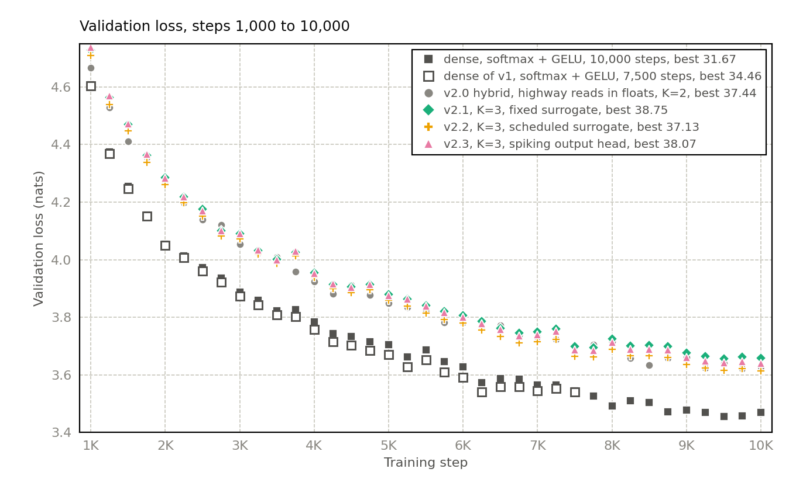
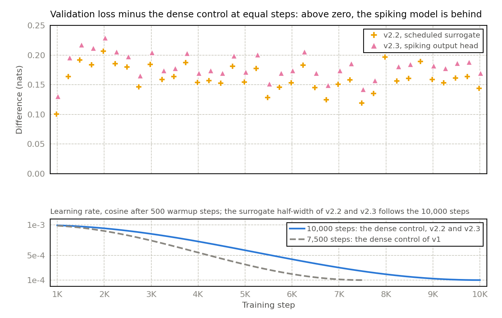
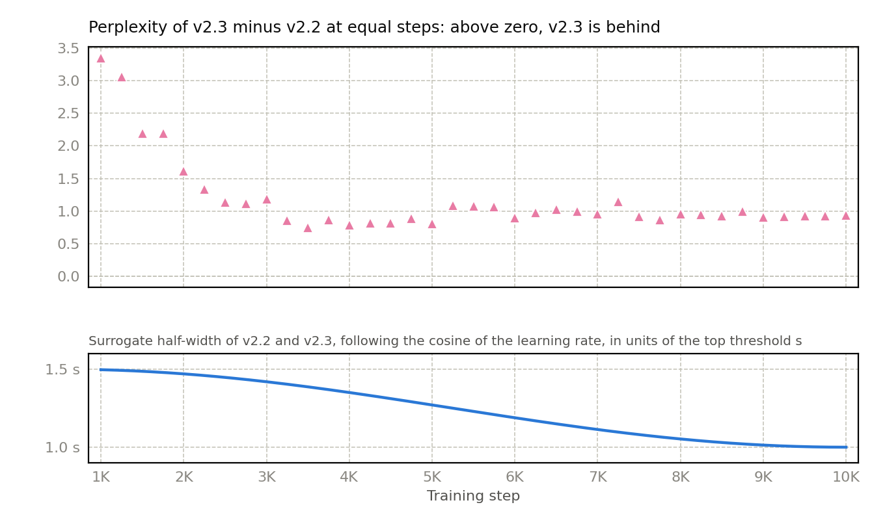

# FS²-SSA: Few-Spike, Softmax-Free Spiking Self-Attention

**A causal spiking language model on FineWeb-Edu (~94M parameters): no softmax anywhere, every matrix product fed by spikes, the output head included, and an exact linear recurrence for inference.**

[](LICENSE)
[](https://doi.org/10.5281/zenodo.22950217)
[](https://huggingface.co/Matt-94/FS-SSA-LM-100M)

In this architecture the continuous Softmax is discarded entirely in favour of a causally masked, decay-weighted row normalisation. Few-spike (FS) neurons code values as signed discrete spikes in **$K=2$ or $K=3$ timesteps**. Since v2.1 they feed every matrix product of the blocks: the four projections (QKV, the output projection, the two MLP layers) and the two products of the attention. Since v2.3 they feed the output head as well, so every dense floating-point multiply-accumulate (MAC) of the model becomes a sparse synaptic addition (AC). The multiplications left in floating point are elementwise, under 1% of the operations of the matrix products.

The square in the name stands for the two FS of the design: **few-spike** coding and **softmax-free** attention. In file names and code it is written `FS2-SSA`.

This repository is the natural evolution of [FS-SSA](https://github.com/LRMTV94/FS_Softmax_Free_Attention), scaling softmax-free spiking self-attention from synthetic classifiers and toy benchmarks to open-domain autoregressive pretraining.

> [!IMPORTANT]
> **Next: FS²-SSA at about 200M parameters**, trained next to a dense control of the same size and evaluated zero-shot on **ARC-Easy, PIQA and HellaSwag**, as in this release: at 94M the gap of v2.3 to the dense control is 0.18 nats and about one point of accuracy. Details in the [Roadmap](#roadmap).

---

## Development trajectory

1. **Part 1, Ablation and Mechanics (TinyShakespeare):** a ~2.7M parameter character-level model (6 layers) evaluating stability, causal normalisation and threshold dynamics against a matched full-precision control.

2. **Part 2, Synthetic Scaling Proof (TinyStories):** a ~25.1M parameter model (12 layers, GPT-2 BPE) reaching a validation loss of **1.8163 ± 0.0139** (perplexity **6.15**), matching the loss regime of dense FP32 baselines on child-level narrative generation.

3. **Part 3, Real-World Open-Domain Scaling (FineWeb-Edu, v1):** a **93,884,544** parameter model (16 layers, 9 heads, context 1024, vocabulary 50257) pretrained on ~655M tokens of educational web text, benchmarked head to head against an iso-parameter dense Transformer trained on 7,500 steps, which v2.4.0 trains again on the same 10,000. Full report in [docs/v1.md](docs/v1.md).

4. **Part 4, Linear-time inference (v2.0.0):** the same trained model, run as an exact recurrence with a fixed state per head, so that every new token costs the same however many came before. Full description in [docs/v2.md](docs/v2.md).

5. **Part 5, Spiking residual highway (v2.1.0):** the inputs of QKV, of the output projection and of the first MLP layer are coded into spikes too, and the fixed decay of each head becomes a decay computed token by token from those spikes. Its README is in [docs/v2.1.md](docs/v2.1.md).

6. **Part 6, Scheduled surrogate (v2.2.0):** the same $K=3$ model, trained with a surrogate gradient sized to the threshold of each neuron, which narrows as the learning rate decays. The forward pass does not change, and the model reaches the validation loss of the v2.0 hybrid. Its README is in [docs/v2.2.md](docs/v2.2.md).

7. **Part 7, Spiking output head (v2.3.0):** the input of the output head is coded into spikes as well, so every matrix product of the model has a spike operand. It costs 0.025 nats against v2.2, from the first thousand steps to the end of training and on three seeds, with no change in fluency. Its README is in [docs/v2.3.md](docs/v2.3.md).

8. **Part 8, Dense control and zero-shot benchmarks (v2.4.0, this release):** a dense control trained on the same 10,000 steps as v2.2 and v2.3, and the three models evaluated zero-shot on ARC-Easy, PIQA and HellaSwag. At equal training the spikes cost 0.16 to 0.18 nats, and about one point of accuracy.

---

## Key results

<div align="center">

| model | projection inputs | head input | decay | $K$ | steps | validation loss | perplexity | Δ loss to the dense control |
| :--- | :---: | :---: | :---: | :---: | :---: | :---: | :---: | :---: |
| Dense Transformer, Softmax + GELU (reference) | floats | floats | softmax | n/a | 10,000 | 3.4554 | 31.67 | *ref* |
| Dense Transformer, the control of v1 | floats | floats | softmax | n/a | 7,500 | 3.5399 | 34.46 | +0.0845 |
| FS-SSA hybrid, v1 and v2.0 | floats | floats | fixed ladder | 2 | 10,000 | 3.6228 | 37.44 | +0.1674 |
| FS²-SSA v2.1 | spikes | floats | data-dependent | 3 | 10,000 | 3.6573 | 38.75 | +0.2018 |
| FS²-SSA v2.2, scheduled surrogate | spikes | floats | data-dependent | 3 | 10,000 | 3.6145 | 37.13 | +0.1591 |
| **FS²-SSA v2.3, spiking output head** | **spikes** | **spikes** | **data-dependent** | **3** | **10,000** | **3.6395** | **38.07** | **+0.1841** |

</div>

1. **At equal training the spikes cost 0.16 to 0.18 nats.** The dense control of v2.4.0 is trained on the recipe of v2.2 and v2.3: the same 10,000 steps, learning rate and data. It reaches **31.67** (3.4554, at step 9,500), and v2.2 is 0.159 nats behind it, v2.3 0.184. The tables up to v2.3 measured the gap against the control of v1, trained on a schedule of 7,500 steps, and found 0.075 and 0.100: at equal training the cost of the spikes is about twice that.

2. **The cost holds through training.** At equal steps v2.2 is behind the dense control by 0.183, 0.156 and 0.165 nats over steps 1,500 to 3,000, 4,000 to 6,000 and 8,000 to 10,000, and v2.3 by 0.204, 0.175 and 0.189 nats. Details under [A dense control on the same 10,000 steps](#a-dense-control-on-the-same-10000-steps).

3. **On the benchmarks the order of the loss holds, by about one point.** Zero-shot, with the accuracy normalised by the length of the answer, the dense control is ahead of v2.2, and v2.2 of v2.3, on ARC-Easy, PIQA and HellaSwag: **42.20**, **41.53** and **40.83** on the mean of the three. Paired question by question, the gap between the dense control and v2.3 is resolved on the mean, $+1.38 \pm 0.81$ points, and the log-likelihood margins of the answers put the dense control ahead of both on ARC-Easy and HellaSwag. Details under [Zero-shot benchmarks](#zero-shot-benchmarks).

4. **Spikes on the projection inputs, and what v2.1 recovers.** Coding the inputs of QKV, of the output projection and of the first MLP layer into spikes costs 0.131 nats with the fixed ladder of the hybrid. A decay computed from the spikes and a third timestep recover 74% of that cost: v2.1 at $K=3$ reaches 38.75. Details in [docs/v2.1.md](docs/v2.1.md).

5. **A surrogate sized to each threshold reaches the hybrid.** v2.2 trains the model of v2.1 from the same initial weights, on the same batches, with a surrogate gradient whose half-width is proportional to the threshold of each neuron and narrows from $1.5\,s$ to $1.0\,s$ with the learning rate. It reaches 37.13, level with the hybrid; the hybrid was trained with the old surrogate, so this does not show that spiking the inputs comes for free. Details in [docs/v2.2.md](docs/v2.2.md).

6. **The spiking head costs 0.025 nats, at every step and on three seeds.** v2.3 codes the input of the output head into spikes, so the last dense layer, 28.95 million MACs per token, becomes additions. Trained from the weights and batches of v2.2, it reaches 38.07, 0.0250 nats behind, with an offset of about 0.02 nats from step 1,000 to the end; seeds 0 and 2, stopped at step 2,500, stay behind v2.2 at every evaluation after the first. Details under [The spiking output head](#the-spiking-output-head) and in [docs/v2.3.md](docs/v2.3.md).

7. **Exact recurrence, and fluency unchanged.** On the published checkpoints of v2.1 and v2.3 the parallel and the recurrent forms give identical logits in float64. The paired fluency tests, 30 prompts with 5 continuations each scored with GPT-2 large, find no difference between v2.2 and v2.1, and none between v2.3 and v2.2 that holds from one run to the next.

<p align="center">
  
</p>

---

## A dense control on the same 10,000 steps

Up to v2.3 every table measured the gap to the dense control of v1: Softmax + GELU, the same 16 layers, width, heads and context, trained on a schedule of 7,500 steps, 491M tokens against the 655M of the spiking runs. The control of v2.4.0 is trained by `v2.4.0/model.py`, the `model.py` of v2.3.0 with this run as the one entry of `CONFIGS`: the same 10,000 steps of 64 sequences of 1024 tokens, the same learning rate and schedule, the same data. Its batches are not those of v2.2 and v2.3, since the dense model consumes the random state of the initialisation differently; at these gaps the order of the batches counts little, as the three seeds of v2.3 differ by 0.011 nats.

<div align="center">

| validation loss | v2.2 minus the dense control | v2.3 minus the dense control |
| :--- | :---: | :---: |
| steps 1,500 to 3,000 | +0.183 | +0.204 |
| steps 4,000 to 6,000 | +0.156 | +0.175 |
| steps 8,000 to 10,000 | +0.165 | +0.189 |
| best against best | +0.159 | +0.184 |

</div>

<p align="center">
  
</p>

The dense control has its best at step 9,500, 3.4554, and ends at 3.4705: from one evaluation to the next its validation estimate moves by up to 0.015 nats. Its checkpoint on Hugging Face, `Dense_Baseline/model.pt`, is the one of step 9,500, as for every run the checkpoint of its best evaluation.

The control of v1 was not saturated. [docs/v1.md](docs/v1.md) stopped it at step 7,500 because its validation loss had flattened, and read the flattening as saturation; its history records a schedule of 7,500 steps, so its learning rate had reached the minimum there. On the 10,000-step schedule the same model is at 3.5459 at step 7,500, with its learning rate still decaying, and goes on to 3.4554 at step 9,500. The gaps of v1, +0.0829 nats for the hybrid, were measured against a control with a quarter fewer tokens; against the new control the hybrid is 0.1674 nats behind.

---

## Zero-shot benchmarks

`v2.4.0/zero_shot.py` evaluates the dense control, v2.2 and v2.3 through the LM Evaluation Harness of EleutherAI (lm-eval), zero shot: ARC-Easy on its test split of 2,376 questions, PIQA and HellaSwag on their validation splits of 1,838 and 10,042 questions. Every choice is scored by its log-likelihood after the question, one sequence per forward pass, about 53,000 requests per model. `acc` takes the choice with the highest log-likelihood; `acc_norm` divides it by the length of the choice in characters first, so that a long answer is not penalised for its length, and is the accuracy usually reported for HellaSwag.

<div align="center">

| acc_norm, % | validation loss | ARC-Easy | PIQA | HellaSwag | mean of the three |
| :--- | :---: | :---: | :---: | :---: | :---: |
| chance | | 25.0 | 50.0 | 25.0 | 33.3 |
| dense control | 3.4554 | **40.19** | **58.43** | **27.98** | **42.20** |
| v2.2, float head | 3.6145 | 39.73 | 57.45 | 27.39 | 41.53 |
| v2.3, spiking head | 3.6395 | 38.51 | 56.96 | 27.01 | 40.83 |

| acc, % | ARC-Easy | PIQA | HellaSwag | mean of the three |
| :--- | :---: | :---: | :---: | :---: |
| dense control | 44.70 | 58.49 | 27.16 | 43.45 |
| v2.2, float head | 43.94 | 58.60 | 26.76 | 43.10 |
| v2.3, spiking head | 42.72 | 58.00 | 26.88 | 42.53 |

</div>

The 95% intervals of a single accuracy are about $\pm 2.0$ points on ARC-Easy, $\pm 2.3$ on PIQA and $\pm 0.9$ on HellaSwag. Since every model answers the same questions, the pairs are compared question by question:

<div align="center">

| paired, acc_norm in points | ARC-Easy | PIQA | HellaSwag | mean of the three |
| :--- | :---: | :---: | :---: | :---: |
| dense control minus v2.2 | $+0.46 \pm 1.56$ | $+0.98 \pm 1.75$ | $+0.59 \pm 0.59$ | $+0.68 \pm 0.80$ |
| dense control minus v2.3 | $\mathbf{+1.68 \pm 1.58}$ | $+1.47 \pm 1.74$ | $\mathbf{+0.98 \pm 0.60}$ | $\mathbf{+1.38 \pm 0.81}$ |
| v2.2 minus v2.3 | $+1.22 \pm 1.55$ | $+0.49 \pm 1.71$ | $+0.39 \pm 0.56$ | $+0.70 \pm 0.79$ |

| paired, margin in nats | ARC-Easy | PIQA | HellaSwag |
| :--- | :---: | :---: | :---: |
| dense control minus v2.2 | $\mathbf{+0.112 \pm 0.092}$ | $+0.058 \pm 0.161$ | $\mathbf{+0.932 \pm 0.143}$ |
| dense control minus v2.3 | $\mathbf{+0.203 \pm 0.095}$ | $+0.105 \pm 0.179$ | $\mathbf{+1.003 \pm 0.144}$ |
| v2.2 minus v2.3 | $+0.091 \pm 0.092$ | $+0.047 \pm 0.177$ | $+0.072 \pm 0.119$ |

</div>

With `acc_norm` the order of the validation loss holds on every task: the dense control first, then v2.2, then v2.3, about one point apart. With `acc` it **holds** on **ARC-Easy**, while on **PIQA** and **HellaSwag** the three models are **within 0.6 points**. Paired question by question, the gap between the dense control and v2.3 is resolved on ARC-Easy, on HellaSwag and on the mean of the three; the other gaps stay inside their intervals, the one between v2.2 and v2.3 included. 

The margin of a question, the log-likelihood of the right answer minus that of the best wrong one, moves on every question, where an accuracy moves only when a margin changes sign: on ARC-Easy and HellaSwag it puts the dense control ahead of both spiking models, by about one nat per question on HellaSwag, whose answers are whole sentences. PIQA separates none of the three. All three are close to chance on HellaSwag, 27 to 28% against 25%.

At this scale the 0.16 to 0.18 nats of the spikes are worth about one point of accuracy, and the 0.025 nats of the spiking head stay inside the intervals. Every question of every model, with the log-likelihood of every choice, is in `v2.4.0/results/zero_shot`, together with the report printed by the script.

---

## The spiking output head

In v2.2 the final RMSNorm reached the output head as floats, and the head, $W_{head}$ tied to the embedding, cost $576 \times 50{,}257 = 28.95$ million MACs per token: 31% of the multiply-accumulates of the projections and the head together, the largest floating-point cost left. v2.3 codes the RMSNorm into signed spikes before the head, as every other read:

<div align="center">

| output head | v2.2 | v2.3 |
| :--- | :--- | :--- |
| input of $W_{head}$ | final RMSNorm, floats | `fs_head`: signed FS code of the final RMSNorm, $K=3$ |
| cost per token | 28.95 million MACs | additions of columns of $W_{head}$, one per spike |
| parameters | 94,750,992 | 94,761,936: 10,944 more, the thresholds, resets and readouts of the two codes and the gain, 19 per channel |

</div>

`fs_head` has the threshold scale of the reads, $s = 0.75\,\sigma$, learns its thresholds per channel and keeps the gain $\alpha$ of the other signed pairs. It is built after the initialisation with the random state put back, so every other weight and every batch are those of the v2.2 run: their difference at equal steps is the cost of the spiking head.

<p align="center">
  
</p>

The cost is an offset of about 0.02 nats from the first thousand steps to the end of training: 0.022, 0.019 and 0.024 nats over steps 1,500 to 3,000, 4,000 to 6,000 and 8,000 to 10,000, and from step 7,500 to their best the two runs gain about the same, 0.048 and 0.050 nats. On the published checkpoint the recurrent form gives the logits of the parallel one in float64 and the same validation loss in float32, 3.66596 against 3.66604; seeds 0 and 2 stay behind v2.2 at every evaluation after the first, 0.017 to 0.039 nats over steps 1,500 to 2,500; and two runs of the paired fluency test find no difference that holds from one run to the next. The tables of these checks are in [docs/v2.3.md](docs/v2.3.md).

---

## How it works

**Few-spike neurons.** Each FS neuron (Stöckl & Maass, 2021) encodes a value in $K$ timesteps: at each step it fires if its membrane potential exceeds a threshold, subtracts a reset and adds a readout to its output. Thresholds, resets and readouts are learnable per channel. Training goes through a triangular surrogate gradient, which since v2.2 is sized to the threshold of each neuron and narrows during training.

**Signed spikes restore suppression.** With non-negative Q and K every causal logit is $\ge 0$, so a token can be weighted less but never suppressed. Signed ON/OFF pairs on Q and K restore inhibition without reintroducing dense MACs: **$-11.71$ perplexity** in v1 ($70.82 \to 59.11$). The reads of v2.1, and the read of the output head in v2.3, are signed pairs as well.

**RMSNorm instead of BatchNorm.** `BatchNorm1d` over `(B, C, T)` pools statistics over time, so in a causal model position $t$ would see future tokens. RMSNorm normalises over channels only.

**Causal row normalisation.** Without a Softmax the attention rows do not sum to 1, so each row is divided by the accumulated weight of the keys it attends to: the row sum of the decay matrix, which in v2.1 changes with the tokens.

**Per-head decay ladder.** Nine values of $\gamma$, geometrically spaced so that the effective windows $1/(1-\gamma)$ run from 8 to 1024 tokens: the whole decay of the fixed runs, the starting point of the gates in the data-dependent ones.

<div align="center">

| head | 1 | 2 | 3 | 4 | 5 | 6 | 7 | 8 | 9 |
|---|---|---|---|---|---|---|---|---|---|
| $\gamma$ | 0.875 | 0.93184 | 0.96284 | 0.97974 | 0.98895 | 0.99398 | 0.99672 | 0.99821 | 0.99902 |
| window | 8 | 15 | 27 | 49 | 91 | 166 | 304 | 558 | 1024 |

</div>

**Channel gains.** A learnable gain $\alpha_c$ per channel on every signed pair, initialised uniformly in $(0.1, 1)$, restores heterogeneity between channels: **$-4.64$ perplexity** in v1 ($50.50 \to 45.86$).

**Where spikes replace multiplications.** Every matrix product has a spike operand: the four projections of each block, the gate and, since v2.3, the output head (real weights with spikes), $q k^\top$ (spikes with spikes) and the attention weights with $v$ (reals with spikes). Floating point remains in the residual additions, the RMSNorms, the channel gains, the decay and the normalisation of the state ($\gamma_t S$, $1/Z_t$) and the softplus and exponential of the gate (9 per token and block), counted in [Spikes and floating point, per token](#spikes-and-floating-point-per-token).

---

## Spikes and floating point, per token

Spikes do not remove floating point: the weights stay real numbers. They remove multiplications. When the input of a matrix product is a spike, the product of a weight and its input becomes the addition of the weight, a synaptic addition (AC) instead of a multiply-accumulate (MAC). The tables count the operations of one generated token in the recurrent form ($d = 576$, 16 blocks, 9 heads of 64, $K = 3$), each matrix product as a dense model computes it, one operation per weight and input.

<div align="center">

| one token | v2.2 | v2.3 |
| :--- | :---: | :---: |
| matrix products with a spike operand: additions | 64,963,584 | **93,911,616** |
| matrix products on floats: multiply-accumulates | 28,948,032, the output head | **0** |
| elementwise multiplications in floating point | 812,880 | 813,456 |
| multiplications in floating point, share of all the operations above | 31.4% | **0.86%** |

</div>

The matrix products are the four projections of each block (63,700,992), the decay gates (82,944), the two products of the attention state, $k_t^\top v_t$ and $q_t S_t$ (1,179,648), and the output head (28,948,032). In v2.3 every one of them has a spike operand. What floating point keeps:

<div align="center">

| floating point left in v2.3 | where | per token |
| :--- | :--- | :---: |
| decay of the state, $\gamma_t S$ and $\gamma_t Z$ | every head of every block | 589,968 multiplications |
| RMSNorm, squares and scaling by $1/\text{rms}$ | 97 norms of 576 channels | 111,744 multiplications |
| RMSNorm weights | the same 97 norms; they can be folded into the thresholds of the code that follows | 55,872 multiplications |
| channel gains $\alpha$ | 81 signed pairs; they can be folded into the weights that follow | 46,656 multiplications |
| normaliser of the state, $\text{scale}/Z_t$ | every output of the attention | 9,216 multiplications |
| reciprocal square roots, softplus, exponentials, divisions | norms, gates, normalisers | 529 functions |
| FS neurons: compare with a threshold, then add or subtract a step | every coded value, 3 timesteps | 418,176 additions |
| residual connections, biases, ON minus OFF | every block | about 149,000 additions |

</div>

Almost three quarters of the multiplications left are the decay of the state, which the decay as a shift of the [roadmap](#roadmap) would turn into shifts and subtractions; a fifth are the RMSNorms, the target of the spiking RMSNorm. Without the gains and the norm weights, which are constants, the multiplications are 0.76% of the operations of the matrix products.

The additions are counted as the operations they replace. The additions actually performed are that count times the spikes of each input: on a unit Gaussian input a signed code at $K=3$ fires 1.51 spikes per value and the MLP neuron 0.61 ([Three timesteps, K = 3](docs/v2.1.md#three-timesteps-k--3)), which would make about 121 million additions where a dense model computes 92.7 million multiply-accumulates in the projections, the gates and the head. An addition costs less than a multiply-accumulate, so the saving depends on that ratio and on the spikes of the trained model, which are not counted yet.

---

## Runs (FineWeb-Edu, ~94M, ~655M tokens)

<div align="center">

| model | name in `v2.1.0/results/history` | parameters | best iter | val loss | perplexity | Δ loss | Δ PPL |
| :--- | :--- | :---: | :---: | :---: | :---: | :---: | :---: |
| Dense, Softmax + GELU, 10,000 steps | `softmax + gelu 10k`, in `v2.4.0/results/history` | 93,340,800 | 9500 | 3.4554 | 31.67 | *ref* | *ref* |
| Dense, Softmax + GELU, 7,500 steps | `softmax + gelu`, in `v2.0.0/results/history` | 93,340,800 | 7500 | 3.5399 | 34.46 | +0.0845 | +2.79 |
| Hybrid, v1 and v2.0 | `ssa K=2 +/- L + alpha_app + gamma_var`, in `v2.0.0/results/history` | 93,884,544 | 9750 | 3.6228 | 37.44 | +0.1674 | +5.77 |
| v2.1, fixed ladder, $K=2$ | `ssa K=2 +/- L g var alpha app` | 94,253,184 | 9750 | 3.7542 | 42.70 | +0.2988 | +11.03 |
| v2.1, data-dependent decay, $K=2$ | `ssa K=2 +/- L g var alpha app data decay` | 94,336,272 | 10000 | 3.6991 | 40.41 | +0.2437 | +8.74 |
| v2.1, data-dependent decay, $K=3$ | `ssa K=3 +/- L g var alpha app data decay` | 94,750,992 | 9500 | 3.6573 | 38.75 | +0.2018 | +7.08 |
| v2.2, scheduled surrogate, $K=3$ | `ssa K=3 +/- L g var alpha app data decay width sched`, in `v2.2.0/results/history` | 94,750,992 | 10000 | 3.6145 | 37.13 | +0.1591 | +5.46 |
| **v2.3, spiking output head, $K=3$** | `ssa K=3 +/- L g var alpha app data decay width sched spike head`, in `v2.3.0/results/history` | 94,761,936 | 10000 | **3.6395** | **38.07** | **+0.1841** | **+6.40** |

</div>

All the v2.1 runs share one setting: 10,000 steps of 64 sequences of 1024 tokens, AdamW with $\beta = (0.9, 0.999)$ and weight decay 0.15, peak learning rate $10^{-3}$ after 500 warmup steps with a cosine down to $10^{-4}$, gradient clipping at 1.0, surrogate half-width 1.1, seed 1. The three runs are the three entries of `CONFIGS` in `v2.1.0/model.py`, under the names above.

The v2.2 run keeps that setting and replaces the fixed half-width 1.1 with the schedule of [What is new in v2.2](docs/v2.2.md#what-is-new-in-v22). It is the one entry of `CONFIGS` in `v2.2.0/model.py`.

The v2.3 run keeps the setting of v2.2 and codes the input of the output head into spikes, as in [The spiking output head](#the-spiking-output-head). It is the one entry of `CONFIGS` in `v2.3.0/model.py`; seeds 0 and 2 ran on the same schedule and stopped at step 2,500, with their histories in `v2.3.0/results/stability_seed`.

The dense control of v2.4.0 keeps the setting of v2.2 and v2.3, apart from what only a spiking model uses, the surrogate and its schedule. It is the one entry of `CONFIGS` in `v2.4.0/model.py`. The control of v1 ran on a schedule of 7,500 steps.

The v1 ablation (sign, static decay, channel gains, per-head ladder), the convergence analysis and the qualitative probes are in [docs/v1.md](docs/v1.md).

---

## Qualitative probing

<div align="center">

| probe | test case | v2.3: observed behaviour | v2.3 | v2.2 | v2.1 | v1 |
| :--- | :--- | :--- | :---: | :---: | :---: | :---: |
| Long-range agreement | *"The teacher, along with the students [...]"* | continues with *"had been given a copy of the book"*, without the verb; the margin prefers **`was`** by 1.32 nats | **PASS** | PASS | FAIL | PASS, `was` |
| Long-range agreement | *"The samples [...] lake bed [...]"* | resolves to plural **`were`** | **PASS** | PASS | PASS | PASS |
| In-context binding | *Alvarez / Mehta* | answers *"the glaciers of the Sierra Nevada"*; the margin still prefers `volcanoes`, for the word, not for the name | **FAIL** | WARN | FAIL | PASS, `volcanoes` |
| Domain fluency | *photosynthesis* | leaves the topic for metallurgy in its second sentence | **FAIL** | FAIL | PASS | PASS |
| Domain fluency | *prime numbers*, *ocean floor* | a list of letters and numbers, then off topic; on topic but circular (*"The ocean floor should be open, and the ocean floor should be open"*) | **WARN** | WARN | WARN | not in the v1 table |
| Decoding stability | greedy rollouts | periodic attractor loops (*"The capital of France is Paris."* repeated, *"10. Solid"* repeated to the end, *"the value of the value ..."*) | **WARN** | WARN | WARN | WARN |
| Factual induction | capital cities, colour cycles | *"Paris"* again for Spain, *"fruit, and grapefruit"* instead of purple | **FAIL** | FAIL | FAIL | FAIL |
| Symbolic arithmetic | *2 + 2*, eggs in cartons, *7 times 8* | *"1.5 = 1.5"*, *"a total of 12 eggs"*, *"1.5 times the value of the original"* | **FAIL** | FAIL | FAIL | FAIL |
| Code and lists | factorial, states of matter, mean | `1`, then *"the value of the value"* repeated, then *"10. Solid"* repeated, then *"the values of the variables in the table"* | **FAIL** | FAIL | FAIL | not in the v1 table |

</div>

Outputs of `v2.3.0/generate.py` on the v2.3 checkpoint, seed 1234, one completion per prompt: the prose set is sampled at temperature 0.8 with top-k 200, every other set is greedy. The v2.2 column repeats the verdicts of [docs/v2.2.md](docs/v2.2.md), the v2.1 column those of [docs/v2.1.md](docs/v2.1.md), the v1 column the table of [docs/v1.md](docs/v1.md). Single completions are probes, not a benchmark: the [zero-shot benchmarks](#zero-shot-benchmarks) and the fluency test measure what one completion cannot. The log-prob margins of the agreement and binding probes, for the hybrid, v2.1, v2.2 and v2.3, are in [docs/v2.3.md](docs/v2.3.md#log-prob-margins-for-the-probes): none of the four models binds the object to the name asked.

---

## Quick start

Training needs a GPU. `v2.4.0/model.py` and `v2.3.0/model.py` are single-file Colab scripts: they stream and tokenise FineWeb-Edu, then train the runs listed in `CONFIGS`, saving checkpoints and histories to Drive. A run whose history is complete is skipped. In every version folder `generate.py` and `recurrent_check.py` are self-contained: they carry the classes of the trained model.

The scripts of v2.3.0 and v2.4.0 read every model from Hugging Face, and `fluency.py` and `recurrent_check.py` rebuild the validation split from the FineWeb-Edu stream: they need nothing but themselves and the published weights. `zero_shot.py` also needs lm-eval; it runs about 160,000 requests for the three models, three quarters of them HellaSwag, several hours on one GPU, and writes its files after every task of every model, so that it starts again from the first one missing.

```bash
python -m venv .venv && source .venv/bin/activate
pip install torch matplotlib numpy tiktoken datasets huggingface_hub transformers tqdm lm-eval

python v2.4.0/model.py             # v2.4: tokenises FineWeb-Edu, trains the dense control on the 10,000 steps of v2.2 and v2.3
python v2.4.0/zero_shot.py         # v2.4: ARC-Easy, PIQA and HellaSwag, zero shot, for the dense control, v2.2 and v2.3
python v2.4.0/diagnostic.py        # v2.4: tables and figures against the dense control, from the histories of v2.2.0, v2.3.0 and v2.4.0

python v2.3.0/model.py             # v2.3: tokenises FineWeb-Edu, trains the K=3 model with the spiking output head
python v2.3.0/diagnostic.py        # v2.3: tables and figures against v2.2, v2.1, the hybrid and the dense control of v1
python v2.3.0/generate.py          # v2.3: generation test against v2.2, weights from Hugging Face
python v2.3.0/recurrent_check.py   # v2.3: parallel against recurrent form, weights from Hugging Face
python v2.3.0/fluency.py           # v2.3: fluency against v2.2 on 30 prompts, scored with GPT-2 large
```

The scripts of v2.2, v2.1 and v2.0 are in their folders, with the commands of their READMEs in [docs/](docs/).

Loading the v2.3 checkpoint in the same session and generating one recurrent step per token:

```python
import torch

# FSGPT, gamma_ladder, ckpt_path_of and the constants below are defined in v2.3.0/model.py
model = FSGPT("ssa", "fs", 3, True, True, QK_SCALE, MLP_SCALE, BLOCK, True, gamma_ladder(N_HEADS, W_MIN, W_MAX), True)
checkpoint = torch.load(ckpt_path_of("ssa K=3 +/- L g var alpha app data decay width sched spike head", 1), map_location="cpu")
model.load_state_dict(checkpoint["model_state_dict"])
model.eval()

idx = torch.tensor([tokenizer.encode_ordinary("The process of photosynthesis")])
out = model.generate_recurrent(idx, 200, temperature=0.8, top_k=200)
print(decode(out[0].tolist()))
```

The last argument of `FSGPT` chooses the decay: `True` for the data-dependent one, `False` for the fixed ladder. In `v2.3.0/model.py` the SSA model always carries the spiking head; the evaluation scripts of v2.3.0 and v2.4.0 take it out for a checkpoint that does not have it. The dense control loads into the same classes as `FSGPT("softmax", "gelu", 2, False, False, QK_SCALE, MLP_SCALE, BLOCK, False, None, False)`. On [Hugging Face](https://huggingface.co/Matt-94/FS-SSA-LM-100M) the file `model.pt` (about 1.8 GB) is the v2.0 hybrid at perplexity 37.14, `v2.1.0/model.pt` is the $K=3$ checkpoint the v2.1.0 scripts read (`HF_FILE`), `v2.2.0/model.pt` is the checkpoint of v2.2, `v2.3.0/model.pt` the checkpoint of v2.3 and `Dense_Baseline/model.pt` the dense control of v2.4.0, the last three read by `v2.4.0/zero_shot.py`.

---

## Roadmap

**Done in v2.1:** spikes on the inputs of QKV, of the output projection and of the first MLP layer; the data-dependent decay; $K=3$; the recurrent form verified on the trained $K=3$ checkpoint.

**Done in v2.2:** a surrogate gradient sized to the threshold of each neuron, with unit area and a width that narrows with the learning rate; a paired fluency test; log-prob margins for the probes.

**Done in v2.3:** the input of the output head coded into spikes, so that every matrix product has a spike operand; the recurrent form verified on the trained v2.3 checkpoint; two more seeds to step 2,500; the fluency test run twice, with the loops set apart from the reference loss; evaluation scripts that read every model from Hugging Face.

**Done in v2.4:** a dense control trained on the same 10,000 steps as v2.2 and v2.3; ARC-Easy, PIQA and HellaSwag zero shot for the dense control, v2.2 and v2.3, paired question by question.

1. **Scaling to about 200M parameters, the next goal.** The v2.3 model at about 200M parameters, trained next to a dense control of the same size, to see whether the gap to the dense model, 0.18 nats and about one point of accuracy at 94M, closes with size. Both evaluated zero-shot on **ARC-Easy, PIQA and HellaSwag** with `v2.4.0/zero_shot.py`, against the numbers of this release.

2. **Spikes counted on the trained model**, at every code and at the head, to turn the additions of [Spikes and floating point, per token](#spikes-and-floating-point-per-token) into an energy estimate.
3. **The hybrid with the scheduled surrogate**, to measure what spiking the inputs still costs with the same backward pass.

4. **The two stages of the surrogate gain, apart.** From one checkpoint in the stable phase of a warmup, stable, decay schedule (Hägele et al., 2024), two cooldowns: one narrowing the surrogate, one keeping it fixed.

5. **Decay as a shift.** Values of $\gamma$ rounded to $1 - 2^{-n}$, so that the decay of the state becomes a shift and a subtraction.

6. **Spiking RMSNorm.** Built and tested as a standalone module: the reciprocal square root as a product of factors $1 + 2^{-k}$ chosen by $K=2$ FS neurons, largest error $2^{-9} = 0.195\%$ over 47 decades of input.

7. **Extended iteration budgets**, 50,000 to 100,000 steps, to find where the descent still visible at 10k steps settles.

8. **Matched multi-seed runs** at full budget, for the v2.1, v2.2 and v2.3 runs, the dense control and the whole v1 ablation ladder.

9. **WikiText-2** evaluation of the 25M architecture, for comparability with published numbers.

---

## Repository

```
v2.0.0/                       v1 and v2.0: the hybrid model and its recurrent form
├── model.py                  model, training sweep, sanity checks
├── diagnostic.py             diagnostics and figures, as a Colab cell after model.py
├── generate.py               generation test; self-contained, published weights or Drive checkpoints
├── recurrent_check.py        parallel against recurrent form; self-contained, like generate.py
├── results/history/          training histories of v1: the ablation and the dense control
├── results/stability_seed/   multi-seed stability runs
└── figures/                  convergence curves

v2.1.0/                       v2.1: the spiking residual highway
├── model.py                  model, training sweep, checks; CONFIGS holds the three runs of the results
├── diagnostic.py             comparison table and scatter figures of the runs in results/history
├── generate.py               generation test on the K=3 model; self-contained, published weights or Drive checkpoints
├── recurrent_check.py        parallel against recurrent form on the K=3 model; self-contained, like generate.py
├── results/history/          training histories of the three runs
└── figures/                  validation curves

v2.2.0/                       v2.2: the scheduled surrogate
├── model.py                  the K=3 model of v2.1 with the scheduled surrogate; training and checks
├── diagnostic.py             tables and figures: the four runs, their last evaluations, the paired difference
├── generate.py               generation test; self-contained, published weights or Drive checkpoints
├── recurrent_check.py        parallel against recurrent form; self-contained, like generate.py
├── fluency.py                fluency against v2.1: 30 prompts, 5 continuations each, scored with GPT-2 large
├── results/history/          training history of the v2.2 run, with copies of the three it is compared with
└── figures/                  validation loss, the last evaluations, the paired difference

v2.3.0/                       v2.3: the spiking output head
├── model.py                  the v2.2 model with the input of the output head coded into spikes; training and checks
├── diagnostic.py             tables and figures: the five runs, the paired difference, the three seeds, the fluency test
├── generate.py               generation test against v2.2; self-contained, weights from Hugging Face
├── recurrent_check.py        parallel against recurrent form; self-contained, weights from Hugging Face
├── fluency.py                fluency against v2.2: 30 prompts, 5 continuations each, scored with GPT-2 large
├── results/history/          training history of the v2.3 run; the runs it is compared with are read from v2.2.0
├── results/stability_seed/   seeds 0 and 2 of v2.3, stopped at step 2,500 on the schedule of the full run
├── results/fluency/          continuations, blind reading and reports of the fluency test
└── figures/                  validation loss, the last evaluations, the paired difference, the seeds, the fluency test

v2.4.0/                       v2.4: the dense control on 10,000 steps and the zero-shot benchmarks
├── model.py                  the model.py of v2.3.0 with the dense control as the one entry of CONFIGS
├── diagnostic.py             tables and figures: every run against the dense control, the two dense controls
├── zero_shot.py              ARC-Easy, PIQA and HellaSwag zero shot through lm-eval; self-contained, weights from Hugging Face
├── results/history/          training history of the dense control; the runs it is compared with are read from v2.2.0 and v2.3.0
├── results/zero_shot/        every question of every model with its log-likelihoods, the accuracies and the printed report
└── figures/                  validation loss with the dense control, the difference from it above the learning rate

docs/
├── v1.md                     v1 in full: analysis, baseline halt, multi-seed, probes
├── v2.md                     v2.0: the recurrent form and its verification
├── v2.1.md                   v2.1: its README, with the probes and the figure of the K=3 model
├── v2.2.md                   v2.2: its README, with the scheduled surrogate and the first fluency test
└── v2.3.md                   v2.3: its README, with the recurrent form, the three seeds, the two fluency tests and the margins
CHANGELOG.md                  what changed in each version
```

Each version folder holds its scripts together with the histories and figures they produced.

Checkpoints are not in the repository: the pretrained weights are on [Hugging Face](https://huggingface.co/Matt-94/FS-SSA-LM-100M), `model.pt` for v2.0, `v2.1.0/model.pt` for the $K=3$ model of v2.1, `v2.2.0/model.pt` for v2.2, `v2.3.0/model.pt` for v2.3 and `Dense_Baseline/model.pt` for the dense control of v2.4.0.

---

## References

* Stöckl & Maass, *Optimized spiking neurons can classify images with high accuracy through temporal coding with two spikes*, Nature Machine Intelligence 3, 230–238 (2021).

* Zhou et al., *Spikformer: When Spiking Neural Network Meets Transformer*, ICLR 2023.

* Yao et al., *Spike-driven Transformer*, NeurIPS 2023.

* Sun et al., *Retentive Network: A Successor to Transformer for Large Language Models*, 2023. The per-head decay ladder is the multi-scale decay of RetNet; v2 also uses its recurrent formulation.

* Gu & Dao, *Mamba: Linear-Time Sequence Modeling with Selective State Spaces*, 2023. Decay computed from the input.

* Dao & Gu, *Transformers are SSMs: Generalized Models and Efficient Algorithms Through Structured State Space Duality*, ICML 2024. The scalar decay per head, computed from the input, used by the gate of v2.1.
* Linzen, Dupoux & Goldberg, *Assessing the Ability of LSTMs to Learn Syntax-Sensitive Dependencies*, TACL 2016.

* Zenke & Vogels, *The Remarkable Robustness of Surrogate Gradient Learning for Instilling Complex Function in Spiking Neural Networks*, Neural Computation 33(4), 899–925 (2021). Learning is robust to the shape of the surrogate and sensitive to its scale.

* Li et al., *Differentiable Spike: Rethinking Gradient-Descent for Training Spiking Neural Networks*, NeurIPS 2021. A surrogate whose sharpness changes during training.

* Hägele et al., *Scaling Laws and Compute-Optimal Training Beyond Fixed Training Durations*, NeurIPS 2024. The warmup, stable, decay schedule.

* Radford et al., *Language Models are Unsupervised Multitask Learners*, 2019. GPT-2; GPT-2 large scores the fluency test.

* Karpathy, [nanoGPT](https://github.com/karpathy/nanoGPT). The baseline architecture and hyperparameters this follows.

* Vaswani et al., *Attention Is All You Need*, NeurIPS 2017.

* Clark et al., *Think you have Solved Question Answering? Try ARC, the AI2 Reasoning Challenge*, 2018. ARC-Easy.

* Bisk et al., *PIQA: Reasoning about Physical Commonsense in Natural Language*, AAAI 2020.

* Zellers et al., *HellaSwag: Can a Machine Really Finish Your Sentence?*, ACL 2019.

* Gao et al., *The Language Model Evaluation Harness*, EleutherAI, [lm-evaluation-harness](https://github.com/EleutherAI/lm-evaluation-harness). The zero-shot evaluation of v2.4.0.

* Lo Russo M.V., *Few-Spikes Transformer with Spiking Self-Attention*, https://doi.org/10.5281/zenodo.22048497

* Lo Russo M.V., *FS-SSA-GPT*, https://doi.org/10.5281/zenodo.22702448

---

## Citation

```bibtex
@software{lorusso_fs2ssa_2026,
  author    = {Lo Russo, Matteo Vito},
  title     = {FS$^2$-SSA: Few-Spike, Softmax-Free Spiking Self-Attention},
  year      = {2026},
  publisher = {Zenodo},
  doi       = {10.5281/zenodo.22950217},
  url       = {https://doi.org/10.5281/zenodo.22950217}
}
```

Thanks for your.... Attention! 😄
