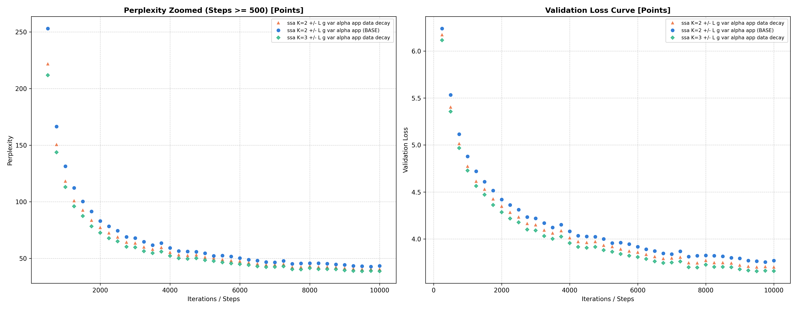

# FS²-SSA: Few-Spike, Softmax-Free Spiking Self-Attention

**A causal spiking language model on FineWeb-Edu (~94M parameters): no softmax anywhere, every matrix product inside the blocks fed by spikes, and an exact linear recurrence for inference.**

[](LICENSE)
[](https://doi.org/10.5281/zenodo.22950217)
[](https://huggingface.co/Matt-94/FS-SSA-LM-100M)

In this architecture the continuous Softmax is discarded entirely in favour of a causally masked, decay-weighted row normalisation. Few-spike (FS) neurons code values as signed discrete spikes in **$K=2$ or $K=3$ timesteps**, and in v2.1 they feed every matrix product of the blocks: the four projections (QKV, the output projection, the two MLP layers) and the two products of the attention. Inside the blocks a dense floating-point multiply-accumulate (MAC) becomes a sparse synaptic addition (AC); the output head is the only dense layer left.

The square in the name stands for the two FS of the design: **few-spike** coding and **softmax-free** attention. In file names and code it is written `FS2-SSA`.

This repository is the natural evolution of [FS-SSA](https://github.com/LRMTV94/FS_Softmax_Free_Attention), scaling softmax-free spiking self-attention from synthetic classifiers and toy benchmarks to open-domain autoregressive pretraining.

---

## Development trajectory

1. **Part 1, Ablation and Mechanics (TinyShakespeare):** a ~2.7M parameter character-level model (6 layers) evaluating stability, causal normalisation and threshold dynamics against a matched full-precision control.

2. **Part 2, Synthetic Scaling Proof (TinyStories):** a ~25.1M parameter model (12 layers, GPT-2 BPE) reaching a validation loss of **1.8163 ± 0.0139** (perplexity **6.15**), matching the loss regime of dense FP32 baselines on child-level narrative generation.

3. **Part 3, Real-World Open-Domain Scaling (FineWeb-Edu, v1):** a **93,884,544** parameter model (16 layers, 9 heads, context 1024, vocabulary 50257) pretrained on ~655M tokens of educational web text, benchmarked head to head against an iso-parameter, compute-matched dense Transformer. Full report in [docs/v1.md](docs/v1.md).

4. **Part 4, Linear-time inference (v2.0.0):** the same trained model, run as an exact recurrence with a fixed state per head, so that every new token costs the same however many came before. Full description in [docs/v2.md](docs/v2.md).

5. **Part 5, Spiking residual highway (v2.1.0, this release):** the inputs of QKV, of the output projection and of the first MLP layer are coded into spikes too, and the fixed decay of each head becomes a decay computed token by token from those spikes.

---

## Key results

| model | projection inputs | decay | $K$ | validation loss | perplexity |
| :--- | :---: | :---: | :---: | :---: | :---: |
| Dense Transformer, Softmax + GELU (reference) | floats | softmax | n/a | 3.5399 | 34.46 |
| FS-SSA hybrid, v1 and v2.0 | floats | fixed ladder | 2 | 3.6228 | 37.44 |
| FS²-SSA v2.1 | spikes | fixed ladder | 2 | 3.7542 | 42.70 |
| FS²-SSA v2.1 | spikes | data-dependent | 2 | 3.6991 | 40.41 |
| **FS²-SSA v2.1** | **spikes** | **data-dependent** | **3** | **3.6573** | **38.75** |

1. **Spiking the projection inputs costs 0.131 nats with the fixed ladder.** Coding the inputs of QKV, of the output projection and of the first MLP layer into spikes, instead of passing them as floats, moves the perplexity from 37.44 to 42.70.

2. **A decay computed from the spikes recovers 42% of that cost.** The data-dependent decay reaches 40.41 ($-0.0551$ nats) with 83,088 more parameters, 0.09% of the model.

3. **A third timestep recovers another 32%.** At $K=3$ the model reaches **38.75** ($-0.0419$ nats): 74% of the cost of the spiking inputs is recovered. The remaining gap is **+0.0344 nats** (+1.31 perplexity points) to the hybrid and +0.1174 nats to the dense control.

4. **The gains hold at every stage of training.** At equal steps, averaged over steps 1,500 to 3,000, 4,000 to 6,000 and 8,000 to 10,000, the data-dependent decay is ahead of the fixed ladder by 0.078, 0.063 and 0.064 nats, and $K=3$ is ahead of $K=2$ by 0.060, 0.053 and 0.043 nats. Each run uses seed 1; for scale, an independent rerun of the hybrid landed 0.008 nats from the original (3.6147 against 3.6228).

5. **Exact recurrence on the trained weights.** On the published $K=3$ checkpoint the parallel and the recurrent forms give identical logits in float64 and the same validation loss in float32 (3.69110 against 3.69117).

6. **Two qualitative probes regress against v1.** At $K=3$ the binding of Alvarez to volcanoes and the singular agreement across *"along with the students"* fail, where v1 passed both; the full table is under [Qualitative probing](#qualitative-probing).

<p align="center">
  <picture>
    <source media="(prefers-color-scheme: dark)" srcset="v2.1.0/figures/val_loss_vs_epochs.png">
    
  </picture>
</p>

---

## What is new in v2.1

### Spiking residual highway

In v2.0 three products had a spike operand ($q k^\top$, the attention weights with $v$, the second MLP layer), while the other three projections received floats and stayed dense MACs. v2.1 codes every one of those inputs into signed spikes:

| projection | input in v2.0 | input in v2.1 |
| :--- | :--- | :--- |
| $W_{qkv}$ | RMS-normed residual, floats | `fs_in`: signed FS code of the RMS-normed residual |
| $W_{proj}$ | attention output, floats | `fs_o`: signed FS code of the RMS-normed attention output |
| $W_{up}$ | RMS-normed residual, floats | `mlp.fs_in`: signed FS code of the RMS-normed residual |
| $W_{down}$ | spikes of the MLP FS neuron | unchanged |

The residual stream stays a real-valued accumulator, a membrane shortcut: $x \leftarrow x + \text{attn}(x)$, then $x \leftarrow x + \text{mlp}(x)$. Each branch normalises and codes its own input, so there is no norm outside the branches. The output head still reads floats.

The reads share the thresholds of the Q/K/V codes, $s = 0.75\,\sigma$ of the RMS-normed input; the MLP neuron sits at $1.0\,\sigma$ of the pre-activation of the first MLP layer. Both spreads are measured at initialisation.

### Data-dependent decay

The fixed ladder gives each head one $\gamma$. In v2.1 each head decays with its own $\gamma$ at every token:

$$\gamma_{t,h} = \exp\big(-\text{softplus}(w_h \cdot s_t + b_h + \beta_h)\big)$$

where $s_t$ is the spike input of $W_{qkv}$, so the gate is itself an all-AC product with $576 \times 9$ weights per block. $\beta_h$ holds the fixed ladder, $\text{softplus}(\beta_h) = -\ln \gamma_h$, as a buffer; $w_h$ and $b_h$ start at zero. At initialisation every token decays with the ladder, so the model starts as the one with the fixed ladder, and weight decay pulls the gate back towards the ladder rather than towards short windows. A scalar decay per head computed from the input, with a softplus inside an exponential, is also the form of the selective state spaces of Mamba-2.

Training uses the parallel form, with $c_t = \sum_{l \le t} \ln \gamma_l$:

$$o_t = \frac{\text{scale}}{Z_t} \sum_{j \le t} D_{tj} \, (q_t \cdot k_j) \, v_j, \qquad D_{tj} = \prod_{j < l \le t} \gamma_l = e^{c_t - c_j}, \qquad Z_t = \sum_{j \le t} D_{tj}$$

Inference uses the recurrent form, with the same state as v2.0:

$$S_t = \gamma_t \, S_{t-1} + k_t^\top v_t, \qquad Z_t = \gamma_t \, Z_{t-1} + 1, \qquad o_t = \text{scale} \cdot \frac{q_t S_t}{Z_t}$$

The state is still $64 \times 64$ per head plus one normaliser, so every new token costs the same however many came before. `v2.1.0/recurrent_check.py` runs the checks of v2.0 on the published $K=3$ checkpoint:

<p align="center">

| check on the $K=3$ checkpoint | result |
| :--- | :--- |
| logits, float64, 2 x 1024 tokens | **identical** in the two forms, same argmax on every token |
| logits, float32, 2 x 1024 tokens | same argmax on **83.6%** of the tokens |
| validation loss, float32, 10 batches | **3.69110** parallel, **3.69117** recurrent |
| generation, 256 tokens on a GPU | 38.0 s parallel, 36.8 s recurrent |
</p>

In float64 the logits are not just close but identical: every attention output goes through a spike read before $W_{proj}$, and the read absorbs the rounding differences between the two forms. In float32 a spike whose input sits within rounding distance of its threshold can still fire in one form and not in the other. v2.1 has more of those thresholds than v2.0, seven coding sites per block instead of four and three steps per code, so the top prediction moves on about one token in six instead of one in twenty. The loss does not move.

The price is paid in training memory: the decay matrix is no longer one per head but one per sequence, 341 MB of activations per sequence and block at 1024 tokens instead of 232 MB. The runs use 8 sequences per forward pass and 8 accumulation steps, the same 65,536 tokens per step as before.

### Three timesteps, K = 3

The $K=3$ run gives three timesteps to every FS neuron (the reads, the Q/K/V codes, the MLP neuron): one K for the whole model, with the same threshold scales as the $K=2$ runs. With the thresholds $T_k = s \cdot 2^{-k}$, the third step halves the smallest step of the code and widens its window from $1.5\,s$ to $1.75\,s$.

<p align="center">

| code on a unit Gaussian input | $K=2$ | $K=3$ |
| :--- | :---: | :---: |
| signed code at $s = 0.75\,\sigma$ (reads, Q, K): window | $1.125\,\sigma$ | $1.313\,\sigma$ |
| saturated inputs | 26.1% | 18.9% |
| correlation with the input | 0.964 | 0.977 |
| spikes per value | 0.97 | 1.51 |
| MLP neuron at $s = 1.0\,\sigma$: correlation with GELU | 0.954 | 0.978 |
| spikes per value | 0.37 | 0.61 |
</p>

The third step costs one more timestep of latency and about 1.6 times the spikes per value.

---

## How it works

**Few-spike neurons.** Each FS neuron (Stöckl & Maass, 2021) encodes a value in $K$ timesteps: at each step it fires if its membrane potential exceeds a threshold, subtracts a reset and adds a readout to its output. Thresholds, resets and readouts are learnable per channel. Training goes through a triangular surrogate gradient.

**Signed spikes restore suppression.** With non-negative Q and K every causal logit is $\ge 0$, so a token can be weighted less but never suppressed. Signed ON/OFF pairs on Q and K restore inhibition without reintroducing dense MACs: **$-11.71$ perplexity** in v1 ($70.82 \to 59.11$). The reads of v2.1 are signed pairs as well.

**RMSNorm instead of BatchNorm.** `BatchNorm1d` over `(B, C, T)` pools statistics over time, so in a causal model position $t$ would see future tokens. RMSNorm normalises over channels only.

**Causal row normalisation.** Without a Softmax the attention rows do not sum to 1, so each row is divided by the accumulated weight of the keys it attends to: the row sum of the decay matrix, which in v2.1 changes with the tokens.

**Per-head decay ladder.** Nine values of $\gamma$, geometrically spaced so that the effective windows $1/(1-\gamma)$ run from 8 to 1024 tokens: the whole decay of the fixed runs, the starting point of the gates in the data-dependent ones.

| head | 1 | 2 | 3 | 4 | 5 | 6 | 7 | 8 | 9 |
|---|---|---|---|---|---|---|---|---|---|
| $\gamma$ | 0.875 | 0.93184 | 0.96284 | 0.97974 | 0.98895 | 0.99398 | 0.99672 | 0.99821 | 0.99902 |
| window | 8 | 15 | 27 | 49 | 91 | 166 | 304 | 558 | 1024 |

**Channel gains.** A learnable gain $\alpha_c$ per channel on every signed pair, initialised uniformly in $(0.1, 1)$, restores heterogeneity between channels: **$-4.64$ perplexity** in v1 ($50.50 \to 45.86$).

**Where spikes replace multiplications.** Inside the blocks every matrix product has a spike operand: the four projections and the gate (real weights with spikes), $q k^\top$ (spikes with spikes) and the attention weights with $v$ (reals with spikes). Floating point remains in the residual additions, the RMSNorms, the channel gains, the decay and the normalisation of the state ($\gamma_t S$, $1/Z_t$), the softplus and exponential of the gate (9 per token and block) and the output head, $576 \times 50{,}257$ MACs per token.

---

## Runs (FineWeb-Edu, ~94M, ~655M tokens)

| model | name in `v2.1.0/results/history` | parameters | best iter | val loss | perplexity | Δ loss | Δ PPL |
| :--- | :--- | :---: | :---: | :---: | :---: | :---: | :---: |
| Dense, Softmax + GELU | `softmax + gelu`, in `v2.0.0/results/history` | iso-parameter | 7500 | 3.5399 | 34.46 | *ref* | *ref* |
| Hybrid, v1 and v2.0 | `ssa K=2 +/- L + alpha_app + gamma_var`, in `v2.0.0/results/history` | 93,884,544 | 9750 | 3.6228 | 37.44 | +0.0829 | +2.98 |
| v2.1, fixed ladder, $K=2$ | `ssa K=2 +/- L g var alpha app` | 94,253,184 | 9750 | 3.7542 | 42.70 | +0.2143 | +8.24 |
| v2.1, data-dependent decay, $K=2$ | `ssa K=2 +/- L g var alpha app data decay` | 94,336,272 | 10000 | 3.6991 | 40.41 | +0.1592 | +5.95 |
| **v2.1, data-dependent decay, $K=3$** | `ssa K=3 +/- L g var alpha app data decay` | 94,750,992 | 9500 | **3.6573** | **38.75** | **+0.1174** | **+4.29** |

All the v2.1 runs share one setting: 10,000 steps of 64 sequences of 1024 tokens, AdamW with $\beta = (0.9, 0.999)$ and weight decay 0.15, peak learning rate $10^{-3}$ after 500 warmup steps with a cosine down to $10^{-4}$, gradient clipping at 1.0, surrogate half-width 1.1, seed 1. The three runs are the three entries of `CONFIGS` in `v2.1.0/model.py`, under the names above.

The v1 ablation (sign, static decay, channel gains, per-head ladder), the convergence analysis and the qualitative probes are in [docs/v1.md](docs/v1.md).

---

## Qualitative probing

| probe | test case | v2.1, $K=3$: observed behaviour | v2.1 | v1 |
| :--- | :--- | :--- | :---: | :---: |
| Long-range agreement | *"The teacher, along with the students [...]"* | resolves to plural **`were`**, the number of the nearest noun | **FAIL** | PASS, `was` |
| Long-range agreement | *"The samples [...] lake bed [...]"* | resolves to plural **`were`** | **PASS** | PASS |
| In-context binding | *Alvarez / Mehta* | retrieves **`glaciers`**, the most recent object | **FAIL** | PASS, `volcanoes` |
| Domain fluency | *photosynthesis* | on-topic multi-sentence prose, with circular definitions (*"photosynthesis is the process of photosynthesis"*) | **PASS** | PASS |
| Domain fluency | *prime numbers*, *ocean floor* | fluent and on topic, factually wrong (*"a prime number of 25.5"*, *"the ocean is a living organism"*) | **WARN** | not in the v1 table |
| Decoding stability | greedy rollouts | periodic attractor loops (*"4. Solid 5. Solid ..."*, *"the values of the values ..."*) | **WARN** | WARN |
| Factual induction | capital cities, colour cycles | *"the city of the Holy Roman Empire"* instead of Madrid, *"red, and orange"* instead of purple | **FAIL** | FAIL |
| Symbolic arithmetic | *2 + 2*, eggs in cartons, *7 times 8* | *"2 = 2 = 2 = ..."*, no number, *"1.5 times"* | **FAIL** | FAIL |
| Code and lists | factorial, states of matter, mean | `return 1`, then *"Solid"* repeated with growing numbers, then *"the values of the values"* | **FAIL** | not in the v1 table |

Outputs of `v2.1.0/generate.py` on the published $K=3$ checkpoint, seed 1234, one completion per prompt: the prose set is sampled at temperature 0.8 with top-k 200, every other set is greedy. The v1 column repeats the table of [docs/v1.md](docs/v1.md). Two probes that v1 passed now fail, the agreement across *"along with the students"* and the binding of Alvarez to volcanoes: in both the model takes the most recent candidate instead of the earlier one the sentence refers to. [docs/v1.md](docs/v1.md) put the failure of factual induction down to the lack of data-dependent decay gates: with the gates of v2.1 it still fails. Single completions are probes, not a benchmark.

---

## Quick start

Training needs a GPU. `v2.1.0/model.py` is a single-file Colab script: it streams and tokenises FineWeb-Edu, then trains the runs listed in `CONFIGS`, saving checkpoints and histories to Drive. A run whose history is complete is skipped. In both version folders `generate.py` and `recurrent_check.py` are self-contained: they carry the classes of the trained model and take its weights from Hugging Face (`SOURCE = "hf"`, the default) or from Drive (`"drive"`). The scripts of v2.0 are in `v2.0.0/`, unchanged, and `diagnostic.py` runs as a Colab cell after `model.py`.

```bash
python -m venv .venv && source .venv/bin/activate
pip install torch matplotlib numpy tiktoken datasets huggingface_hub

python v2.1.0/model.py             # v2.1: tokenises FineWeb-Edu, trains the three runs of the results
python v2.1.0/generate.py          # v2.1: generation test on the K=3 model, self-contained
python v2.1.0/recurrent_check.py   # v2.1: parallel against recurrent form on the K=3 model, self-contained

python v2.0.0/model.py             # v1 and v2.0: the hybrid and its ablation
python v2.0.0/generate.py          # v2.0: generation test, self-contained
python v2.0.0/recurrent_check.py   # v2.0: parallel against recurrent form, self-contained
```

Loading a v2.1 checkpoint in the same session and generating one recurrent step per token:

```python
import torch

# FSGPT, gamma_ladder, ckpt_path_of and the constants below are defined in v2.1.0/model.py
model = FSGPT("ssa", "fs", 3, True, True, QK_SCALE, MLP_SCALE, BLOCK, True, gamma_ladder(N_HEADS, W_MIN, W_MAX), True)
checkpoint = torch.load(ckpt_path_of("ssa K=3 +/- L g var alpha app data decay", 1), map_location="cpu")
model.load_state_dict(checkpoint["model_state_dict"])
model.eval()

idx = torch.tensor([tokenizer.encode_ordinary("The process of photosynthesis")])
out = model.generate_recurrent(idx, 200, temperature=0.8, top_k=200)
print(decode(out[0].tolist()))
```

The last argument of `FSGPT` chooses the decay: `True` for the data-dependent one, `False` for the fixed ladder. On [Hugging Face](https://huggingface.co/Matt-94/FS-SSA-LM-100M) the file `model.pt` (about 1.8 GB) is the v2.0 hybrid at perplexity 37.14, and `v2.1.0/model.pt` is the $K=3$ checkpoint the v2.1.0 scripts read (`HF_FILE`).

---

## Roadmap

**Done in v2.1:** spikes on the inputs of QKV, of the output projection and of the first MLP layer; the data-dependent decay; $K=3$; the recurrent form verified on the trained $K=3$ checkpoint.

1. **Spiking output head.** The last dense layer, $576 \times 50{,}257$ MACs per token, the largest floating-point cost left.
2. **Decay as a shift.** Values of $\gamma$ rounded to $1 - 2^{-n}$, so that the decay of the state becomes a shift and a subtraction.
3. **Spiking RMSNorm.** Built and tested as a standalone module: the reciprocal square root as a product of factors $1 + 2^{-k}$ chosen by $K=2$ FS neurons, largest error $2^{-9} = 0.195\%$ over 47 decades of input.
4. **Extended iteration budgets**, 50,000 to 100,000 steps, to find where the descent still visible at 10k steps settles.
5. **Matched multi-seed runs** at full budget, for the v2.1 runs and for the whole v1 ablation ladder.
6. **WikiText-2** evaluation of the 25M architecture, for comparability with published numbers.

---

## Repository

```
v2.0.0/                       v1 and v2.0: the hybrid model and its recurrent form
├── model.py                  model, training sweep, sanity checks
├── diagnostic.py             diagnostics and figures, as a Colab cell after model.py
├── generate.py               generation test; self-contained, published weights or Drive checkpoints
├── recurrent_check.py        parallel against recurrent form; self-contained, like generate.py
├── results/history/          training histories of v1: the ablation and the dense control
├── results/stability_seed/   multi-seed stability runs
└── figures/                  convergence curves
v2.1.0/                       v2.1: the spiking residual highway
├── model.py                  model, training sweep, checks; CONFIGS holds the three runs of the results
├── generate.py               generation test on the K=3 model; self-contained, published weights or Drive checkpoints
├── recurrent_check.py        parallel against recurrent form on the K=3 model; self-contained, like generate.py
├── results/history/          training histories of the three runs
└── figures/                  validation curves
docs/
├── v1.md                     v1 in full: analysis, baseline halt, multi-seed, probes
└── v2.md                     v2.0: the recurrent form and its verification
CHANGELOG.md                  what changed in each version
```

Each version folder holds its scripts together with the histories and figures they produced.

Checkpoints are not in the repository: the pretrained weights are on [Hugging Face](https://huggingface.co/Matt-94/FS-SSA-LM-100M), `model.pt` for v2.0 and `v2.1.0/model.pt` for the $K=3$ model of v2.1.

---

## References

* Stöckl & Maass, *Optimized spiking neurons can classify images with high accuracy through temporal coding with two spikes*, Nature Machine Intelligence 3, 230–238 (2021).
* Zhou et al., *Spikformer: When Spiking Neural Network Meets Transformer*, ICLR 2023.
* Yao et al., *Spike-driven Transformer*, NeurIPS 2023.
* Sun et al., *Retentive Network: A Successor to Transformer for Large Language Models*, 2023. The per-head decay ladder is the multi-scale decay of RetNet; v2 also uses its recurrent formulation.
* Gu & Dao, *Mamba: Linear-Time Sequence Modeling with Selective State Spaces*, 2023. Decay computed from the input.
* Dao & Gu, *Transformers are SSMs: Generalized Models and Efficient Algorithms Through Structured State Space Duality*, ICML 2024. The scalar decay per head, computed from the input, used by the gate of v2.1.
* Linzen, Dupoux & Goldberg, *Assessing the Ability of LSTMs to Learn Syntax-Sensitive Dependencies*, TACL 2016.
* Karpathy, [nanoGPT](https://github.com/karpathy/nanoGPT). The baseline architecture and hyperparameters this follows.
* Vaswani et al., *Attention Is All You Need*, NeurIPS 2017.

* Lo Russo M.V., *Few-Spikes Transformer with Spiking Self-Attention*, https://doi.org/10.5281/zenodo.22048497

* Lo Russo M.V., *FS-SSA-GPT*, https://doi.org/10.5281/zenodo.22702448

---

## Citation

```bibtex
@software{lorusso_fs2ssa_2026,
  author    = {Lo Russo, Matteo Vito},
  title     = {FS$^2$-SSA: Few-Spike, Softmax-Free Spiking Self-Attention},
  year      = {2026},
  publisher = {Zenodo},
  doi       = {10.5281/zenodo.22950217},
  url       = {https://doi.org/10.5281/zenodo.22950217}
}
```

Thanks for your.... Attention! 😄
